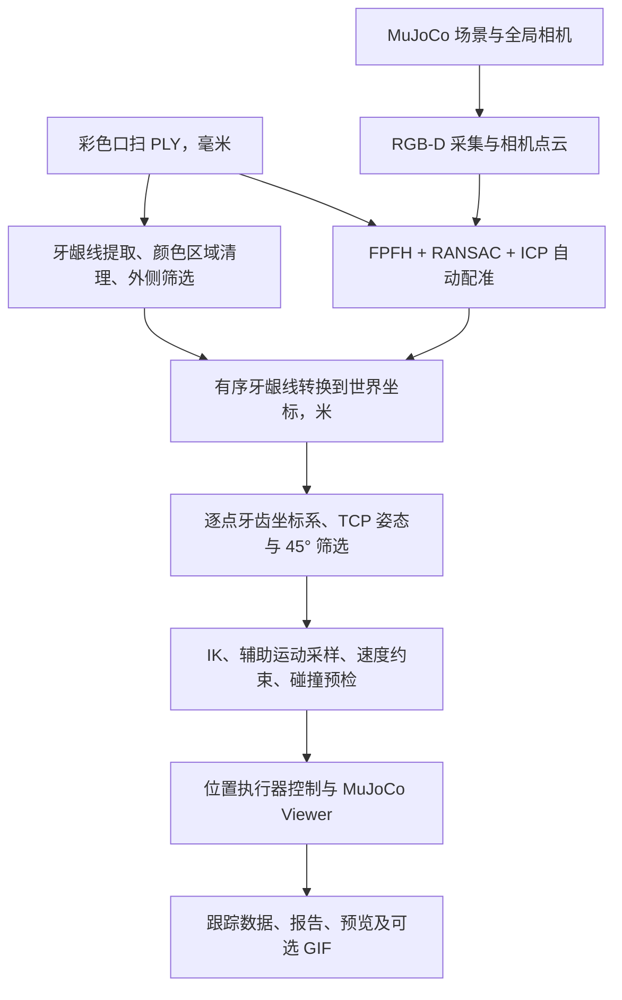

# 洁牙机器人 MuJoCo 仿真

本项目实现从彩色口扫模型、全局 RGB-D 感知、牙龈线配准，到洁治器 TCP 位姿规划和机械臂仿真运动的完整流程。代码按 **感知 perception → 规划 planning → 控制 control** 分层，`pipeline/` 负责组织各阶段、打开仿真窗口并保存结果。

当前使用 UR5e 结构代理、带洁治器的末端和 MuJoCo 全局牙列相机。场景入口为 `models/scene_ur7e_dental.xml`，完整流程入口为 `python -m pipeline.run`。当前运动通过 MuJoCo 位置执行器完成，尚未接入真实机器人或接触力闭环控制。

## 白色椭圆口腔开口（可调尺寸）

牙齿外侧已添加白色弯曲面罩和白色椭圆口缘，默认净开口 **宽 45 mm × 高 80 mm**。开口为真实镂空网格，相机可以从孔洞看到牙齿，外围面罩会遮挡视野。

**先单独查看和调整，无需等待配准或机械臂规划：**

```powershell
Set-Location -LiteralPath 'C:\Users\Administrator\Desktop\teethclean robot'
.\.venv\Scripts\python.exe -m pipeline.preview_mouth
```

在预览窗口中使用：

| 按键 | 功能 |
| --- | --- |
| `J` / `L` | 开口宽度减小 / 增大，每次 2 mm |
| `K` / `I` | 开口高度减小 / 增大，每次 2 mm |
| `U` / `O` | 面罩后移 / 前移，每次 2 mm |
| 方向键 | 面罩左、右、上、下移动，每次 2 mm |
| `S` | 保存当前参数，供后续完整流程使用 |
| `R` | 恢复内置 45 × 80 mm 尺寸和初始位置；仍需 `S` 保存 |
| `M` | 显示 / 隐藏面罩 |
| `C` | 恢复正面观察视角 |

鼠标可旋转、缩放观察。关闭预览不自动保存。也可直接指定尺寸并保存，例如：

```powershell
.\.venv\Scripts\python.exe -m pipeline.preview_mouth --width-mm 60 --height-mm 45 --save
```

参数保存在 `config/mouth_opening.json`；`width_mm` / `height_mm` 分别为净开口全宽 / 全高，允许范围为 10–110 / 10–130 mm。`center_mm` 是面罩中心在牙模口扫坐标系中的毫米坐标，初始 `[0, 10, 45]`，第三项增大表示朝全局相机方向前移。面罩随牙模的安装姿态定位。

完整流程默认读取已保存设置，支持本次运行临时覆盖：

```powershell
.\.venv\Scripts\python.exe -m pipeline.run --jaw mandibular --registration-method automatic --mouth-width-mm 60 --mouth-height-mm 45
```

`--mouth-forward-mm 50` 可临时设置前后位置；`--no-mouth` 隐藏面罩。单独保存渲染预览可用 `python -m pipeline.preview_mouth --render outputs/mouth_preview.png`。直接在原生 MuJoCo 中加载 `models/scene_ur7e_dental.xml` 时显示内置 45 × 80 mm 面罩；Python 入口会应用 JSON 中的设置。

当前面罩用于外观及真实相机遮挡，**不参与接触碰撞**；原有牙模碰撞模式仍由 `--collision-mode` 控制。缩小开口会减少相机可见牙面，可能影响配准。完整运行报告记录实际使用的面罩尺寸和位置。

## 1. 进入仿真场景：自动配准，无需人工选点

打开 **PowerShell**，复制以下命令：

```powershell
Set-Location -LiteralPath 'C:\Users\Administrator\Desktop\teethclean robot'

.\.venv\Scripts\python.exe -m pipeline.run --jaw mandibular --registration-method automatic --max-orientation-step-deg 45
```

该命令运行下颌流程，自动完成以下步骤：

1. 载入机械臂、洁治器、牙模及全局 RGB-D 相机场景。
2. 从彩色口扫 PLY 提取并清理外侧牙龈线。
3. 在当前 MuJoCo 场景中采集 RGB-D，生成相机点云。
4. 通过 **FPFH 特征匹配 + RANSAC 初始配准 + Point-to-Plane ICP 精配准**，将口扫模型与相机点云对齐。
5. 将牙龈线转换到世界坐标，计算 TCP 姿态、筛选姿态跳变、求解 IK 并执行碰撞预检。
6. 预检通过后打开 **MuJoCo Viewer**，执行接近、进入牙龈线、沿线运动及撤离。

这里的“自动选点配准”由算法建立对应关系，**无需在 Open3D 窗口中手工点选对应点**。仿真窗口在感知、配准和规划完成后打开，启动后不会立即出现。关闭 Viewer 会中断本次运动。

**查看运动时不要加 `--headless`。** 该参数会关闭执行窗口，但仍计算并执行仿真。

### 常用启动方式

以下命令均在项目根目录运行。

**自动配准并保存运动动画：**

```powershell
.\.venv\Scripts\python.exe -m pipeline.run --jaw mandibular --registration-method automatic --max-orientation-step-deg 45 --record-gif
```

**全流程不打开窗口：**

```powershell
.\.venv\Scripts\python.exe -m pipeline.run --jaw mandibular --registration-method automatic --headless --record-gif
```

**选择上颌：**

```powershell
.\.venv\Scripts\python.exe -m pipeline.run --jaw maxillary --registration-method automatic
```

上下颌均有入口和模型配置，实际轨迹仍需通过各自的配准、IK 和碰撞预检；下颌的已有运动结果不代表所有上颌路径均可达。

当前 `config/global_camera_registration.json` 中的 `registration_method` 仍是 `manual`。因此推荐在命令中显式写 `--registration-method automatic`；也可自行把配置字段改成 `automatic`，作为以后运行的默认方法。命令行参数优先于配置。

### 环境准备

本机项目已包含 `.venv`，直接使用上面的虚拟环境解释器即可，无需先激活环境。首次准备依赖或遇到缺失模块时运行：

```powershell
.\.venv\Scripts\python.exe -m pip install -r requirements-perception.txt
```

`requirements-perception.txt` 已包含基础 `requirements.txt`，覆盖 MuJoCo、NumPy、Open3D、OpenCV、Matplotlib 和 scikit-learn 等依赖；`requirements-perception-lock.txt` 保存已有环境的版本清单。迁移到新机器且没有 `.venv` 时，可先使用 Python 3.11 创建环境：

```powershell
py -3.11 -m venv .venv
.\.venv\Scripts\python.exe -m pip install -r requirements-perception.txt
```

## 2. 项目架构与数据流



### 目录与模块职责

```text
teethclean robot/
├─ pipeline/                         完整流程组织与仿真执行
│  ├─ run.py                         命令行入口；串联感知、规划、控制
│  ├─ simulation.py                  载入场景、初始化机器人、绘制路径及 TCP 轴
│  └─ tracking.py                    规划调用、Viewer、执行记录及结果报告
├─ perception/                       感知与配准
│  ├─ workflow.py                    提取→采集→配准的总接口
│  ├─ global_camera.py               配置读取、RGB-D 采集和点云保存
│  ├─ frames.py                      相机/世界变换及深度投影
│  ├─ gingival_line.py               CSV/OBJ 读取、连续段排序及世界坐标路径
│  ├─ gingival_extraction/
│  │  ├─ extract.py                  彩色 PLY 牙龈线提取与独立预览入口
│  │  ├─ cleanup.py                  孤立颜色区域及扫描边缘伪线清理
│  │  └─ outer_surface.py            牙弓几何估计与唇侧/颊侧筛选
│  └─ registration/
│     ├─ registration_workflow.py    配准流程、输入一致性检查及结果保存
│     ├─ automatic.py                FPFH、RANSAC、Point-to-Plane ICP
│     ├─ algorithms.py               点云预处理、人工初值及 ICP
│     ├─ registration_math.py        刚体变换与配对数学
│     ├─ landmark_picker.py          人工模式的配对窗口
│     └─ main.py / __main__.py       独立双点云配准入口
├─ planning/                         几何姿态与运动规划
│  ├─ tooth_frames.py                牙齿局部坐标系、坐标变换、导出及三维预览
│  ├─ trajectory.py                  TCP 目标、姿态筛选、关节轨迹与运动时序
│  ├─ ik.py                          六关节 TCP 逆运动学
│  └─ validation.py                  碰撞模式、机器人接触检测与关节扫掠预检
├─ control/
│  └─ position.py                    位置执行器控制、前馈补偿及运行时检查
├─ config/
│  └─ global_camera_registration.json 场景、口扫、相机及配准参数
├─ models/                           场景 XML、机械臂/工具资产及彩色口扫模型
├─ assets/                           既有牙龈线资产与数据来源记录
├─ outputs/                          每次运行的数据、图像、轨迹和报告
├─ tests/                            感知、配准、规划、控制与流程测试
└─ docs/                             结构说明及设计记录
```

| 模块 | 主要输入 | 主要输出 |
| --- | --- | --- |
| 感知 `perception` | 毫米单位的彩色口扫网格、MuJoCo 相机 RGB-D | 牙龈线及拓扑、口扫→相机配准变换、世界坐标连续路径 |
| 规划 `planning` | 连续路径、牙面几何、配准变换、当前关节状态 | 逐点 TCP 位姿、姿态筛选记录、IK 关节解、运动时序及预检结果 |
| 控制 `control` | 规划及当前机器人状态 | MuJoCo `data.ctrl` 指令、跟踪状态及异常停止 |
| 流程 `pipeline` | 颌别、配置、路径及速度等参数 | 同一场景中的完整执行、Viewer、CSV/NPY/JSON 报告及可选动画 |

感知采集和运动执行共用同一个 MuJoCo 模型与状态。完整流程会把本次新提取的牙龈线写入本次配准配置，规划继续使用对应的冻结数据，并检查文件哈希与坐标一致性。生产配准不使用仿真真值作为算法输入；仿真真值另用于独立误差评价。

## 3. 轨迹与洁治器姿态如何计算

### 牙龈线与连续段

提取流程按顶点颜色区分牙齿和牙龈，先清理孤立颜色区域及扫描切边伪线，再提取边界并筛选外侧牙龈线。默认保留唇侧/颊侧，去掉下颌舌侧和上颌腭侧。

断开的线保留为不同连续段，不跨缺口连线。`--path-index 0` 默认选择按长度排序后的最长一段；**一次运行执行一段，不会自动遍历整副牙列的所有连续段**。更换段可使用 `--path-index 1` 等，段数见本次报告。

### 牙齿局部坐标系与 TCP

规划先确定路径执行方向、重采样，再为最终路径点计算牙齿坐标系：

- 原点：对应牙龈线点。
- +X：从牙冠指向牙龈，在局部牙面上的切向投影。
- +Z：牙齿侧网格的外向法线。
- +Y：`Z × X`，组成右手坐标系。

未筛选的 TCP 目标直接采用牙齿三轴，不额外叠加工作倾角。`--offset-mm 0` 时两者原点重合；非零偏移沿每点牙齿 +Z 施加。

默认按执行顺序跳过相对**上一个保留点**旋转角超过 45° 的牙齿姿态约束。保留点继续精确对齐牙齿三轴；被跳过位置的姿态沿弧长进行 Slerp 插值，末尾沿用最后有效姿态。**跳过的是姿态约束，全部空间路径点及原终点仍保留。**

随后逐点求 IK，并增加辅助位置/姿态 IK 采样，减小直接插值关节角造成的 TCP 偏离。接近与撤离分别使用首尾实际目标姿态及 TCP +Z 方向。关节扫掠预检通过后才驱动位置执行器运动，运行中继续检查接触及跟踪误差。

### 坐标方向与单位

| 数据 | 变换含义 / 坐标系 | 长度单位 |
| --- | --- | --- |
| 原始口扫 PLY、提取的牙龈线 CSV/OBJ | 口扫坐标 | mm |
| `T_camera_scan_estimated.npy` | 口扫局部 → CV 相机 | 平移 mm |
| `T_world_scan_m`（报告字段） | 口扫局部 → MuJoCo 世界 | 平移 m |
| `T_world_tooth.npy` | 牙齿局部 → MuJoCo 世界 | 平移 m |
| `T_world_tcp.npy` | TCP 局部 → MuJoCo 世界 | 平移 m |
| `target_poses_world_m_rad.csv` | 世界坐标 xyz、roll/pitch/yaw | m / rad |

旋转矩阵的三轴存放在**列向量**中；RPY 对应 `Rz(yaw) · Ry(pitch) · Rx(roll)`。筛选启用后，`T_world_tcp.npy` 是实际使用的目标，`requested_T_world_tcp.npy` 保留筛选前目标，二者仅在被替换的姿态处不同。

当前示例口扫的牙龈参考方向为下颌 `scan -Y`、上颌 `scan +Y`；更换口扫方向或场景时需核对参考向量、牙模放置及姿态可达性，具体接口见 [规划开发说明](planning/README.md)。

## 4. 常用参数与运行速度

| 参数 | 当前默认值 | 用途 |
| --- | --- | --- |
| `--registration-method automatic` | 配置当前为 `manual` | 显式启用无人工点选的自动配准 |
| `--jaw` | `mandibular` | 下颌；`maxillary` 为上颌 |
| `--path-index` | `0` | 选择长度排序后的某一连续段，零基编号 |
| `--max-orientation-step-deg` | `45` | 相对上一个保留姿态的旋转角阈值，单位 ° |
| `--no-orientation-filter` | 不启用 | 关闭筛选，要求每点严格对齐牙齿姿态 |
| `--offset-mm` | `0` | 沿牙齿 +Z 的位置偏移，范围 0–30 mm |
| `--speed-mm-s` | `4` | TCP 沿线速度上限，允许大于 0 且不超过 20 mm/s |
| `--collision-mode` | `geometry` | `geometry` 几何演示；`strict` 保留牙模碰撞 |
| `--headless` | 不启用 | 不打开执行 Viewer；自动模式下全流程无需窗口交互 |
| `--record-gif` | 不启用 | 保存运动 GIF |
| `--scan` | 配置中的对应颌口扫 | 指定带顶点颜色、毫米单位的口扫 PLY |
| `--config` | `config/global_camera_registration.json` | 指定场景与相机配准配置 |
| `--output` | 自动时间戳目录 | 指定输出目录，须不存在或为空 |

**当前运动慢的主要限制是关节限速。** `planning/trajectory.py` 中的规划关节速度上限仍固定为 `0.3 rad/s`，同时有接近至少 8 s、进入至少 4 s、撤离至少 4 s 的阶段时长。因此只把 `--speed-mm-s` 提到 20，不保证当前轨迹明显加快；此前 `1.0 rad/s` 的加速验证是临时仿真实验，未写回当前源码。

默认 `geometry` 模式在内存中关闭牙模凸包碰撞，适用于几何运动演示；其余机器人接触检查继续运行。`strict` 模式保留牙模碰撞，近牙龈轨迹可能在预检时失败。几何模式运动成功不代表接触过程已经验证。

关闭姿态筛选时，当前示例下颌路径曾在索引 4 出现位姿几何不可达；增加 IK 迭代次数不能替代可达性调整。筛选不会自动忽略其他 IK 或碰撞失败。

## 5. 输出文件在哪里看

默认每次运行新建：

```text
outputs/pipeline/<时间戳>/
├─ extraction/                       牙龈线、拓扑、牙齿/牙龈标签及清理报告
├─ capture/                          RGB-D、相机点云及采集元数据
├─ registration/                     配准变换、世界牙龈线、报告及叠加图
├─ tracking/                         实际目标、关节轨迹、跟踪数据及运动预览
├─ registration_config.json          本次运行冻结的配准配置
└─ pipeline_report.json              整体状态、当前阶段及失败原因
```

| 文件 | 查看内容 |
| --- | --- |
| `registration/registration_report.json` | 自动方法、参数、Fitness、RMSE、变换方向 |
| `registration/registration_overlay.png` | 口扫与相机点云的静态配准叠加图 |
| `registration/T_camera_scan_estimated.npy` | ICP 最终口扫→相机变换，平移单位 mm |
| `tracking/target_path_world_m.csv` | 世界坐标下的 TCP 空间路径 |
| `tracking/target_poses_world_m_rad.csv` | 实际逐点 TCP 六维目标 |
| `tracking/T_world_tooth.npy` | 原始牙齿坐标系数组，形状 `(N,4,4)` |
| `tracking/requested_T_world_tcp.npy` | 姿态筛选前的 TCP 目标 |
| `tracking/T_world_tcp.npy` | 姿态筛选后的实际 TCP 目标 |
| `tracking/orientation_selection.csv` | 原始重采样点编号、姿态保留标记及被拒绝角度；启用筛选时生成 |
| `tracking/joint_waypoints_rad.csv` | 含接近、辅助沿线采样及撤离的关节路点 |
| `tracking/trace_joint_commands.csv` | 沿线路径弧长与辅助 IK 关节指令 |
| `tracking/tcp_tracking.csv` | 每步目标/实际位置、位置误差、运动阶段和沿线姿态误差 |
| `tracking/tracking_report.json` | 执行状态、运动时长、位置/姿态误差及完整跳过记录 |
| `tracking/tracking_preview.png` | 运动过程的静态预览 |
| `tracking/tracking.gif` | 添加 `--record-gif` 时生成的运动动画 |

IK 前已保存几何目标和筛选记录；若 IK 失败，仍可检查这些文件，但不会生成完整执行轨迹和动画。需要先看 `pipeline_report.json` 的 `status`、`stage`、`error`，再看对应阶段报告；关闭 Viewer 的状态为 `interrupted`。

已有下颌整段运动示例位于 `outputs/tcp_tooth_skip45_complete/`。该次运行包含 70 个空间目标点，保留 15 个牙齿姿态约束、跳过 55 个，使用 235 个沿线 IK 执行样本；位置最大误差约 0.156 mm、姿态最大误差约 0.092°，计划时长约 276 s。此目录是已有结果，新运行仍保存到各自时间戳目录。

## 6. 单独查看牙龈线与牙齿坐标系

**只提取并查看牙龈线，不执行机械臂运动：**

```powershell
.\.venv\Scripts\python.exe .\perception\gingival_extraction\extract.py `
  --input '.\models\2026615-gch\2026615-gch病例-mandibular.ply' `
  --jaw mandibular `
  --outdir '.\outputs\extraction_test_mandibular'
```

保存后会打开可旋转的三维牙模窗口，叠加牙龈线和采样点；关闭后退出。加 `--no-view` 只导出文件。`--surface all` 提取内外两侧，`--no-cleanup` 关闭颜色区域清理；`--surface all --no-cleanup` 用于对照原始颜色边界结果。这些是独立提取脚本参数，不是 `pipeline.run` 的参数。

**查看某次配准对应的牙齿坐标系：**

```powershell
.\.venv\Scripts\python.exe -m planning.tooth_frames `
  --jaw mandibular `
  --registration-dir '.\outputs\pipeline\20261001_223948_971512\registration' `
  --labels '.\outputs\pipeline\20261001_223948_971512\extraction\mandibular_vertex_labels.ply' `
  --point-index 250 `
  --out '.\outputs\tooth_frames\mandibular_point_250' `
  --view
```

上面使用项目已有结果；查看新一次运行时，将两个时间戳路径一起替换。`--point-index` 是该次原始牙龈 CSV 的零基点编号，不等同于姿态筛选表中的最终重采样编号。牙面网格顶点选择、局部显示、上下颌参考方向及更多导出接口见 [planning/README.md](planning/README.md)。

## 7. 常见问题与开发入口

| 现象 | 检查方法 |
| --- | --- |
| 启动后没有立即出现仿真窗口 | 先看控制台是否仍在提取、自动配准或规划；Viewer 在预检完成后打开，并确认未加 `--headless` |
| 出现人工配对窗口 | 显式加 `--registration-method automatic`；仅加 `--headless` 不会关闭人工配准的点选交互 |
| 提示找不到 `pipeline` 模块 | 先切到本 README 所在项目根目录，使用 `.\.venv\Scripts\python.exe` |
| 提示输出目录非空 | 换一个新的 `--output`，或省略该参数使用自动时间戳目录 |
| ICP/RANSAC 失败或配准位置可疑 | 查看 registration 报告及叠加图，核对颌别、相机覆盖与配置；低 RMSE 不能单独保证牙位正确 |
| IK 或碰撞预检失败 | 查看 tracking 报告、目标矩阵和姿态筛选记录，核对路径、目标角度及机械臂相对牙模的位置 |
| 换了口扫后牙龈线不合理 | 提取依赖颜色与完整牙弓几何，严重缺损、异常颜色、单牙/很小局部口扫需要重新评估方法 |
| 提高 `--speed-mm-s` 后仍然很慢 | 当前轨迹还受 `planning/trajectory.py` 中固定关节速度上限和阶段时长限制 |

修改自动配准算法主要进入 `perception/registration/automatic.py`；修改牙齿坐标系进入 `planning/tooth_frames.py`；修改姿态筛选、IK 调用及轨迹时序进入 `planning/trajectory.py`；修改执行反馈检查进入 `control/position.py`。

进一步说明：

- [项目结构与实现状态](docs/PROJECT_STRUCTURE.md)
- [配准算法开发说明](perception/registration/README.md)
- [牙齿坐标系与轨迹规划说明](planning/README.md)

相关模块及流程测试：

```powershell
.\.venv\Scripts\python.exe -m unittest tests.test_tcp_tooth_alignment tests.test_planning_control tests.test_modular_pipeline tests.test_automatic_registration -v
```

全部测试发现入口：

```powershell
.\.venv\Scripts\python.exe -m unittest discover -s tests -v
```
