# 洁牙机器人 MuJoCo 仿真

本项目提供从仿真 RGB-D 采集、口扫配准和牙龈线处理，到器械姿态选择、轨迹规划、位置控制与恒力实验的模块化工作流。

```text
彩色口扫 + 仿真 RGB-D + 匹配的六区域源线/牙齿分割预测
  -> perception：提取、配准、分区曲线和牙面法向
  -> PreparedRegion
  -> planning：三角度姿态、连续 IK、网格避碰、TOPPRA 时序与动力学验证
  -> control.position：非接触位置控制仿真
  -> control.force：独立的接触/恒力验证实验
```

## 1. 项目入门

### 1.1 环境与前置工作

当前验证环境为 **Windows x64、Python 3.11.9**。其他操作系统和 Python 版本尚未完成安装验收。
当前开发版本位于 `cwj` 分支：

```powershell
git clone --branch cwj https://github.com/chenwenjun0828-dot/teethclean-robot.git
Set-Location teethclean-robot
```

完成 Git 克隆后，在包含本 README、`assets/` 和 `config/` 的项目根目录打开 PowerShell；以下命令均在此执行。
路径含空格时使用引号；使用 `py -3.11`，不要直接采用系统中其他版本的默认 Python。

- 安装 Python 3.11 x64、Git，准备能运行 MuJoCo/Open3D 的图形环境。`--headless` 隐藏交互窗口，RGB-D 采集仍需离屏渲染。
- 安装 [Microsoft C++ Build Tools](https://learn.microsoft.com/en-us/cpp/build/vscpp-step-0-installation)，选择“使用 C++ 的桌面开发”，包含 MSVC x64/x86 工具和 Windows SDK。锁定的 `toppra==0.6.3` 需要源码编译；本机已用 Build Tools 2022 验证。
- 保留完整的 `assets/` 和 `config/`。默认流程依赖扫描、机器人/工具网格、分割预测和区域路径，不能只下载 Python 代码。

```powershell
py -3.11 -m venv .venv
$py = ".\.venv\Scripts\python.exe"
& $py -m pip install --upgrade pip
& $py -m pip install -r requirements.txt -c requirements-perception-lock.txt
& $py -m pip check
& $py -m pipeline.run --params config/pipeline_outer_front.json --dry-run
```

后文沿用 `$py`；新开终端后重新定义该变量即可，不必激活虚拟环境。
本轮在不含旧 `outputs/` 和虚拟环境的独立副本中验证，记录见 [README 命令验收](docs/integration/2026-11-11-readme-command-audit.md)。
原安装记录见 [环境验证](docs/integration/2026-11-11-force-entry-and-installation.md)。

| 依赖文件 | 用途 |
| --- | --- |
| `requirements.txt` | 默认安装入口，包含感知、规划、可视化及控制的完整运行依赖 |
| `requirements-simulation.txt` | 可选的轻量 MuJoCo 场景依赖，不能独立支撑完整 pipeline |
| `requirements-perception.txt` | 保留的完整流程依赖入口，与 `requirements.txt` 一致 |
| `requirements-perception-lock.txt` | 已验证的完整依赖版本；配合 `-c` 约束安装，也可用 `-r` 安装全部锁定包 |
| `requirements-real-camera.txt` | 可选 D405 SDK 和完整流程依赖 |
| `requirements-animation.txt` | 可选 FFmpeg 视频导出依赖；README 的 GIF 已由完整运行依赖中的 Pillow 支持 |

```powershell
# 按需安装
& $py -m pip install -r requirements-real-camera.txt -c requirements-perception-lock.txt
& $py -m pip install -r requirements-animation.txt -c requirements-perception-lock.txt
```

### 1.2 数据、坐标和运行范围

| 输入 | 默认位置 | 说明 |
| --- | --- | --- |
| 仿真场景 | `assets/simulation/scene_ur7e_dental.xml` | 机器人、工具、相机和双颌 |
| 彩色口扫 | `assets/source_cad/teeth/mandibular_scan.ply` | 提取需颜色及三角面，纯 XYZ 点云不能替代 |
| CrossTooth 快照 | `assets/perception/tooth_segmentation/crosstooth_mandibular/` | 已附预测，不需要先训练模型 |
| 六区域源路径 | `assets/regional_paths/mandibular/` | 必须与扫描及预测来源匹配 |
| 仿真相机/配准配置 | `config/global_camera_registration.json` | `--config` 选择此类配置 |
| 运行参数 | `config/pipeline_outer_front.json` | `--params` 选择此类配置，CLI 可覆盖 |
| 口腔与张口设置 | `config/oral_settings.py` | 可用 `--jaw-opening-deg` 等运行时覆盖 |

点云、原始网格和 `T_camera_scan_*` 平移使用 **mm**；`world_from_scan_m` 和规划空间位置使用 **m**；
CLI 三角度为 **度**，关节角为 **rad**，时间为 **s**，力为 **N**。
`T_camera_scan` 是口扫到相机的变换，不能直接当成世界变换。

| 下颌区域 | 含义 |
| --- | --- |
| `outer_left` / `outer_front` / `outer_right` | 外侧左后牙 / 前牙 / 右后牙 |
| `inner_right` / `inner_front` / `inner_left` | 内侧右后牙 / 前牙 / 左后牙 |

每次只规划、执行一个区域，不会自动串联全口。上颌可单独提取和配准，但缺少匹配的六区域输入时不能运行当前完整规划。
更换扫描必须同时准备匹配的分割预测和区域数据，不能复用本例数据或修改哈希绕过检查。
采集、配准、规划和实验示例的输出目录应是**新的空目录**；重复实验请更换目录名。
回放和执行的 `--plan` / `--source` 必须指向已有规划目录，导图会更新指定位置的同名图片。
`outputs/` 默认不纳入 Git，克隆后需要按下面步骤生成，不能直接假设示例产物已经存在。

## 2. 执行完整 Pipeline

先使用已验证的下颌前区参数：

```powershell
$run = "outputs/tutorial/full_front"
& $py -m pipeline.run --params config/pipeline_outer_front.json --output $run --headless
$plan = "$run/tracking"
& $py -m planning.view --plan $plan --speed 1
```

示例使用 `simple` 模式、三角度 `[6.37, 13.26, -0.4]`、张口 20°、离面 1.8 mm、清扫速度上限 1 mm/s。
默认自动决定总时长。这是非接触位置控制示例，其他区域需分别选角和验证。

流程依次完成牙龈线提取、RGB-D 采集、配准、六区域准备、选区姿态与连续 IK、完整工具网格避碰、
进出场、关节样条与 TOPPRA 时序、实际动力学验证。`--headless` 仍执行动力学；已有本轮验收结果时不会重复仿真。

```powershell
# 显示执行窗口，显式指定 GUI 模式
& $py -m pipeline.run --params config/pipeline_outer_front.json --no-headless --output outputs/tutorial/front_gui
# 人工配准仍需选点窗口，headless 不会取消人工输入
& $py -m pipeline.run --params config/pipeline_outer_front.json --registration-method manual --output outputs/tutorial/front_manual
# 只检查输入和参数，不验证 IK、碰撞和执行
& $py -m pipeline.run --params config/pipeline_outer_front.json --dry-run
```

GUI 回放窗口需手动关闭后命令才返回；人工配准还需要完成选点，取消选择不会完成 pipeline。
无人值守验证使用上面的自动配准、`--headless` 命令。

`--no-output` 使用临时目录跑完整流程，结束后删除产物；需要后续预览、独立执行或力控时使用持久目录。

| 产物 | 用途 |
| --- | --- |
| `pipeline_report.json` | 总状态、各阶段耗时、失败原因和仿真边界 |
| `extraction/` | 提取线、颜色标签、清理报告和预览 |
| `capture/` | RGB、深度、毫米点云、相机位姿和来源元数据 |
| `registration/` | 配准矩阵、叠加图、世界坐标牙龈线 |
| `regions/<region>/` | `PreparedRegion`、连续参考、牙面和来源指纹 |
| `tracking/` | 规划报告、姿态、轨迹、审计和位置执行结果 |

成功时检查总报告的 `status=completed`、`dental_collision_validated=true`，
以及 `tracking/planning_report.json` 的 `execution_ready=true` 和执行报告的 `status=completed`。
退出码为 0 本身不能证明轨迹可执行，尤其是仅几何诊断模式。

## 3. 单独运行 Perception

本节按 **3.1 → 3.2 → 3.3 → 3.4** 顺序，从新目录 `outputs/tutorial/manual/` 开始，不要求先执行完整 pipeline。
这里的 `manual` 只是“分步运行”的目录名，第 3.3 节仍默认自动配准。
也可复用完整流程的 `capture/`、`registration/` 或 `regions/`，从对应阶段继续开发。

### 3.1 提取和清理牙龈线

```powershell
& $py -m perception.gingival_extraction `
  --input assets/source_cad/teeth/mandibular_scan.ply `
  --outdir outputs/tutorial/manual/extraction --jaw mandibular --no-view
```

默认执行颜色聚类、分数平滑、边界提取、外表面筛选、线段焊接和小片段清理；上面的命令只导出结果并退出。
需要交互三维叠加窗口时去掉 `--no-view`，关闭窗口后命令才返回。
开发原始轮廓时可用 `--surface all --no-cleanup`，写到另一个目录。
`--clusters`、`--threshold`、`--smooth-iters`、`--weld-mm`、`--min-component-mm` 可分别调整。

输出 `gingival_line_points.csv/.ply`、保留连通关系的 `gingival_line_segments.obj`、
`mandibular_vertex_labels.ply`、清理/表面筛选报告和预览图。只有 CSV 散点不能完整表达线段拓扑。

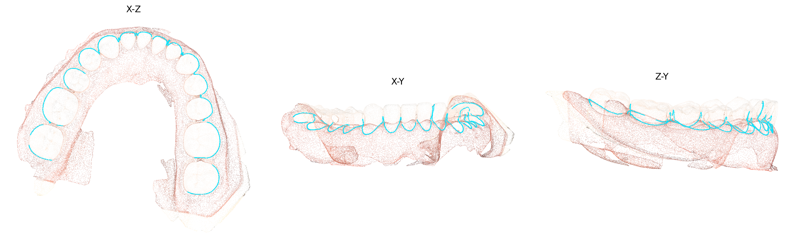

图：本次下颌提取的三视图，青色为提取线。提取线用于配准中间输出；规划参考来自匹配的六区域源线，
修改提取参数不会自动重写六区域数据集。

### 3.2 从仿真采集 RGB-D 和点云

仿真采集使用 Python API。下面的 PowerShell 块可直接执行，只采集，不启动规划或控制：

```powershell
@'
import json
from pathlib import Path
from perception.global_camera import load_config, capture_rgbd, save_capture
from pipeline.simulation import create_simulation
from pipeline.oral import load_jaw_settings, jaw_overrides

root = Path("outputs/tutorial/manual").resolve()
root.mkdir(parents=True, exist_ok=True)
cfg = load_config()
cfg["mandibular_line"] = str(root / "extraction/gingival_line_points.csv")
(root / "registration_config.json").write_text(json.dumps(cfg, indent=2), encoding="utf-8")
model, data = create_simulation(Path(cfg["model"]),
    jaw_settings=jaw_overrides(load_jaw_settings(), 20.0))
frame = capture_rgbd(model, data, cfg["camera"], cfg["width"], cfg["height"])
metadata = save_capture(root / "capture", frame, model, data, "mandibular", cfg)
print("Valid points:", metadata["valid_points"])
'@ | & $py -
```

输出 `rgb.png`、`depth_m.npy`、`depth_preview.png`、`camera_mm.ply`、`valid_mask.npy`、`capture_metadata.json` 等。
不要只移动 PLY：流程配准还需要相机位姿和来源指纹。
当前 `ideal_segmentation` 使用仿真牙颌标签，属于理想输入；真实相机需要独立 ROI、标定和质量评价。
`capture/evaluation/` 真值仅用于独立评价，不能作为待估计变换输入。

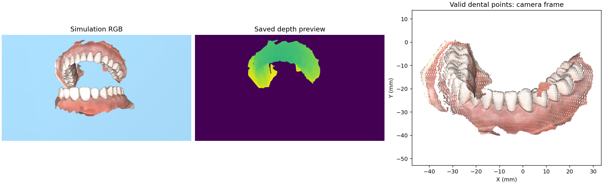

图：同一次采集的相机画面、深度预览和有效牙颌点云；画面可包含 ROI 外场景。

### 3.3 自动/人工配准与世界坐标

继续使用带元数据的采集结果：

```powershell
@'
from pathlib import Path
import numpy as np
from perception.registration import register_capture
from perception.gingival_line import load_registered_paths

root = Path("outputs/tutorial/manual").resolve()
registered = register_capture(root / "capture", root / "registration_config.json",
    "mandibular", root / "registration", registration_method="automatic", show_view=False)
paths = load_registered_paths(registered, "mandibular",
    root / "extraction/gingival_line_segments.obj")
np.save(root / "world_from_scan_m.npy", paths.world_from_scan)
print("Registration:", registered)
'@ | & $py -
```

自动模式使用统计去噪、FPFH、RANSAC 和 Point-to-Plane ICP。设 `show_view=True` 可交互检查叠加。
人工模式改成 `registration_method="manual"` 并使用新目录：左侧相机、右侧口扫，Shift+左键逐对选点，至少六对；
Backspace/Shift+右键撤销，Finish & Register 或 Q 完成，Esc 取消。
可通过 `landmarks=Path(".../landmark_correspondences.json")` 复用同次采集的配对，输入必须匹配。

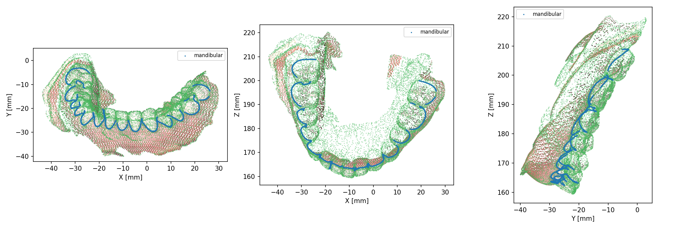

图：配准后三方向叠加。本例 ICP RMSE 约 0.1485 mm；仍需确认牙位和左右方向，低 RMSE 不能单独排除重复牙形错配。
输出包括初始/精配准矩阵、`registration_report.json`、`scan_registered_camera_mm.ply` 和 `mandibular_line_world_m.csv`。
`load_registered_paths` 结合采集元数据得到单位为米的 `world_from_scan_m.npy`。

只研究双点云算法时可用独立 CLI：

```powershell
& $py -m perception.registration `
  --scan assets/source_cad/teeth/mandibular_scan.ply `
  --camera outputs/tutorial/manual/capture/camera_mm.ply `
  --out outputs/tutorial/cloud_registration --voxel-mm 0.5 --no-view
```

两个输入均须为毫米；去掉 `--no-view` 可打开配准叠加窗口。该入口没有采集元数据，仅输出相机坐标，不能直接供世界轨迹执行。
更多参数见 [配准模块](perception/registration/README.md)。

### 3.4 分割与六区域连续曲线

独立校验已附 CrossTooth 预测：

```powershell
& $py -m perception.tooth_segmentation `
  --scan assets/source_cad/teeth/mandibular_scan.ply `
  --prediction-dir assets/perception/tooth_segmentation/crosstooth_mandibular
```

此 CLI 校验 `summary.json`、`segmentation.ply`、`prediction.npz`，不运行神经网络推理。
分割清理与牙面支撑处理由 [tooth_segmentation](perception/tooth_segmentation/README.md) 和 `perception/regions/` 的 API 负责。

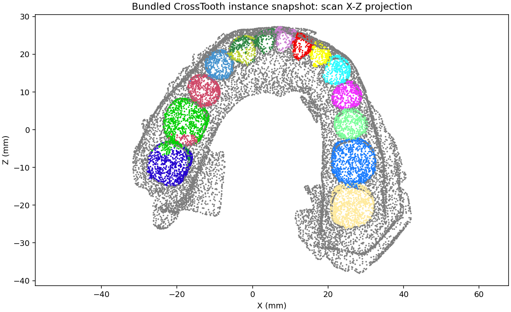

图：已附预测文件的颜色投影，仅展示实例快照，不表示本次重新推理，也不代表临床 FDI 编号认证。

合并六区域源线、分割和本次配准变换：

```powershell
& $py -m perception.regions --jaw mandibular `
  --topology outputs/tutorial/manual/extraction/gingival_line_segments.obj `
  --world-from-scan outputs/tutorial/manual/world_from_scan_m.npy `
  --trim-mm 1 --out outputs/tutorial/manual/regions
```

默认导出六区，也可重复传入 `--region outer_front --region inner_front`。
模块负责区域 B 样条、逐牙归属、牙面法向和整区端点裁剪；默认仅裁剪整区起终点各 1 mm，牙位切换不删段、不补桥。
改变裁剪/拟合策略后要重新导出；planning 不修改已保存的感知曲线。

每个 `regions/<region>/` 包含 `perception_region.json`、`continuous_gingival_line.json/.npz`、`geometry.json/.npz`、
`tooth_planes.json`、`tooth_lookup.npz`、`region_mesh.npz`；有注册变换时另有 `world_from_scan_m.npy` 和世界坐标 CSV。
总索引为 `perception_regions.json`。省略 `--world-from-scan` 可做纯几何开发，后续规划会使用场景牙颌位姿，不能称为使用了感知配准。

六区域源线独立可视化：

```powershell
& $py -m pipeline.path_viewer --placement automatic --headless --output outputs/tutorial/regions_preview
# known 使用已知仿真位姿，不验证配准
& $py -m pipeline.path_viewer --placement known --headless --output outputs/tutorial/regions_known
```

两条命令均保存预览图后退出；去掉 `--headless` 可交互查看，并使用新的输出目录。
`0` 显示全部区域，`1` 至 `6` 选区；自动配准预览中 `R` 切换白色已知位姿参考线的显示。
查看器展示数据集源线，不读取上面导出的 `PreparedRegion`，
也不验证机器人可达性；处理后的单区参考用下一节的 planning 预览检查。

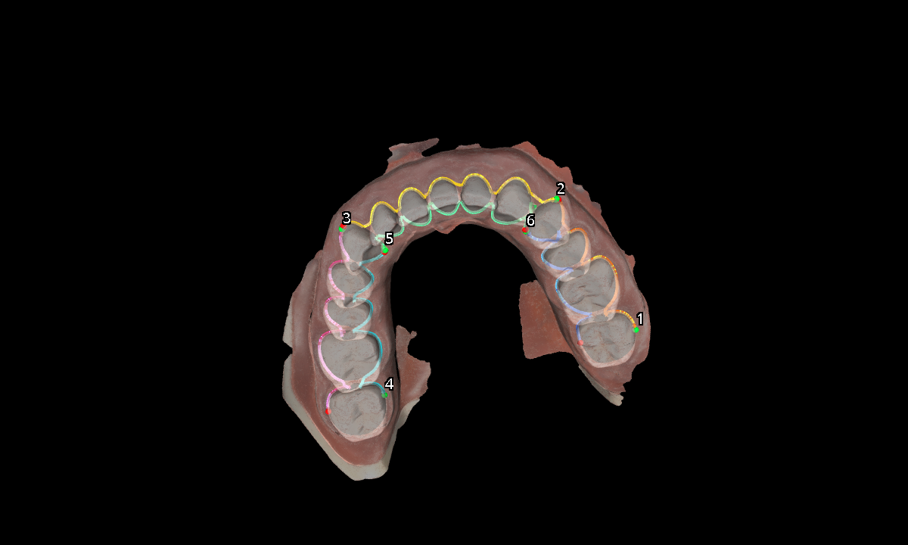

图：已知仿真位姿下的六区域源线，数字对应区域顺序，绿色/红色为起终点。详见 [regions](perception/regions/README.md)。

## 4. 可视化选角与轨迹规划

### 4.1 三角度与姿态模式

使用 `--pose-angles-deg ANGLE AZIMUTH FLIP`，三个值均为度：

| 参数 | 含义 |
| --- | --- |
| `ANGLE` / `fixed_z_angle` | 绕固定重力投影参考轴的角度 |
| `AZIMUTH` / `fixed_y_azimuth` | 绕固定区域参考轴的方位角 |
| `FLIP` / `tool_x_flip` | 工具局部 +X 轴翻转角 |

这是项目定义的牙面/重力参考角，**不是基座 XYZ 欧拉角**。TCP 的 +X 沿器械轴向，+Y 为标记径向；
具体旋转定义见 `planning/pose_search/constraints.py`。
默认 `simple` 使用区域固定参考系，先尝试统一姿态，失败后在每角 ±5° 内搜索统一或平滑局部修正。
显式 `--planning-mode continuous` 则使用局部牙面参考系。

planning 的所有命令均支持 `--params` 读取 `config/` 中的独立参数文件。
下面先介绍选角和规划流程；8 个命令的配置对应关系、启动示例和参数说明见
[第 4.5 节](#45-planning-命令与参数文件速查)。不使用参数文件时，仍可按下面示例逐项传入命令行参数。

### 4.2 交互式角度滑块查看器

此模块可独立运行，在浏览器中调节洁治器的三个角度、离面距离和路径位置，实时观察工作端与牙面的关系。
工具围绕实际 TCP 旋转；网页依赖随项目附带，无需联网或安装 Node.js。

#### 4.2.1 启动与输入

在项目根目录执行，使用附带的下颌区域数据打开查看器，不要求先跑 pipeline：

```powershell
& $py -m planning.visualization.pose_angles --params config/planning_pose_angles.json
```

已有第 3 节的感知结果时，建议明确传入该目录，让选角和后续规划使用同一条路径及配准变换：

```powershell
$prepared = "outputs/tutorial/manual/regions/outer_front"
& $py -m planning.visualization.pose_angles --params config/planning_pose_angles.json `
  --perception-result $prepared --model-scope both
```

启动后自动打开浏览器，默认地址为 `http://127.0.0.1:8765/`；端口被占用时会自动选择可用端口，以终端打印的网址为准。
终端需保持运行，按 Ctrl+C 退出。追加 `--no-browser` 可仅启动服务，`--port 8766` 可指定其他端口。

初始设置保存在 [config/planning_pose_angles.json](config/planning_pose_angles.json)：

| JSON 字段 | 用途 |
| --- | --- |
| `perception_result` | `PreparedRegion` 目录；`null` 表示使用附带数据 |
| `region` | 默认区域；加载感知目录时以目录所属区域为准，可切换同批次的兄弟区域 |
| `pose_angles_deg` | 三角度，顺序为 `[ANGLE, AZIMUTH, FLIP]`，单位为度 |
| `planning_mode` | `simple` 为区域固定参考，`continuous` 为局部牙面参考 |
| `standoff_mm` / `jaw_opening_deg` | 初始离面距离 / 仿真张口角 |
| `model_scope` | `tooth` 局部牙冠、`mandibular` 完整下颌、`both` 上下颌 |
| `port` / `no_browser` | 服务端口 / 是否禁止自动打开浏览器 |

命令行覆盖 JSON 设置，例如追加 `--pose-angles-deg 35 -20 -141 --standoff-mm 2`。
张口角在启动时设置，修改 `jaw_opening_deg` 后需要重新启动查看器。

#### 4.2.2 滑块与显示操作

1. 选择目标区域和“姿态参考”，确保与后续规划的 `region`、`planning_mode` 一致。
2. 拖动三个角度滑块，或在旁边的数字框精确输入。三个角度均支持 -180° 至 180°，定义见第 4.1 节。
3. 调节“离面距离”（0–30 mm）和“路径位置”，分别检查起点、中段、终点的工具姿态。
4. 切换“牙模范围”检查局部工作端、整颌和对颌关系；勾选“完整器械”可显示工具全网格，默认只显示距 TCP 65 mm 内的工作端。
5. 确定候选姿态后，点击顶部复制图标获取三个角度，或点击下载图标导出当前姿态 JSON。

| 操作或控件 | 作用 |
| --- | --- |
| 鼠标拖动 / 滚轮 | 旋转视角 / 缩放，不改变器械姿态参数 |
| TCP 坐标轴 / 固定参考轴 | 查看工具方向及角度使用的参考轴 |
| 牙面选点 | 勾选后点击牙模，在该点按展示网格局部法线比较姿态 |
| 恢复路径参考点 | 退出牙面选点，回到区域默认路径点并保留三个角度 |
| 角度归零 / 适配视角 | 将三个角度设为零 / 重新取景 |

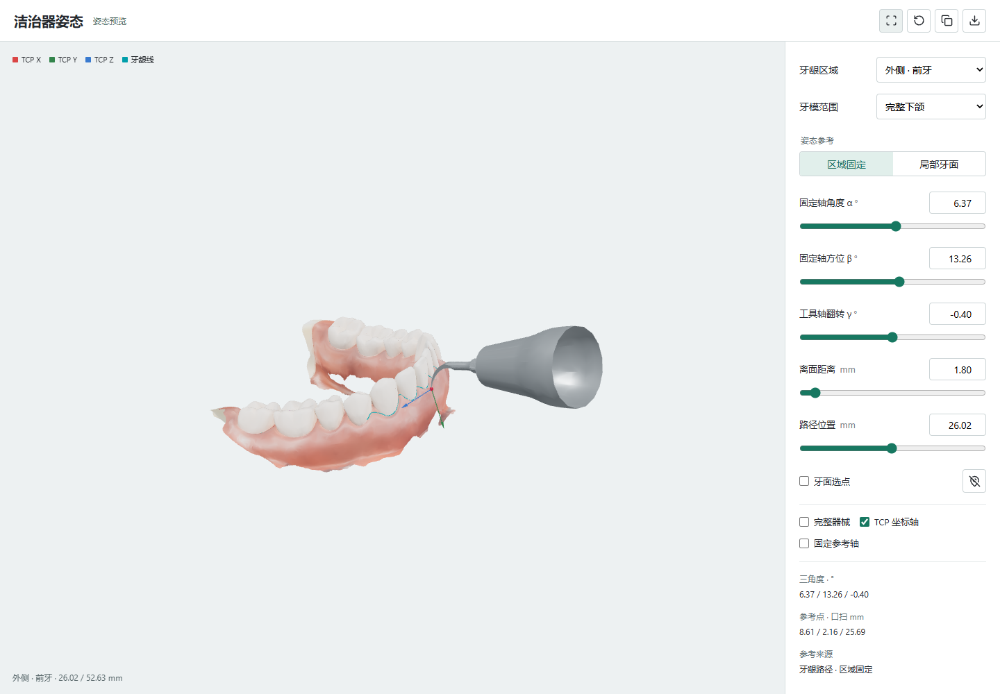

图：三角度、离面距离、路径位置及牙模范围控件与洁治器姿态预览。
路径模式直接复用规划器的姿态计算；牙面选点仅用于观察，不会修改感知路径。
选点使用的局部法线与规划参考可能不同，选角后应先恢复路径参考点，再沿路径核对。

#### 4.2.3 将选定参数用于规划

页面调整不会自动写回 config。可将角度及其他设置分别更新到查看器和主规划的参数文件，或通过命令行覆盖。
下面以 `outer_front`、区域固定参考及角度 `[6.37, 13.26, -0.4]` 为例；使用时替换为页面选定值，
同时保持感知目录、区域、姿态模式、离面距离和张口角一致：

```powershell
$prepared = "outputs/tutorial/manual/regions/outer_front"
$selected = "outputs/tutorial/selected_pose"
& $py -m planning --params config/planning_outer_front.json `
  --perception-result $prepared --region outer_front --planning-mode simple `
  --pose-angles-deg 6.37 13.26 -0.4 --standoff-mm 1.8 --jaw-opening-deg 20 `
  --headless --out $selected
& $py -m planning.view --params config/planning_view.json --plan $selected
& $py -m planning.preview --params config/planning_preview.json --plan $selected
```

`$selected` 必须是新的输出目录。查看器不求解 IK，也不验收碰撞或动力学；完整规划可能在每角 ±5° 内修正姿态，
应通过 `planning.view` 检查实际轨迹，并确认 `planning_report.json` 的 `execution_ready=true`。
下载的姿态 JSON 带有 `preview_only=true`、`execution_ready=false`，用于记录候选参数，不能直接作为 `--params` 配置或控制轨迹。
更多模块细节见 [查看器说明](planning/visualization/README.md)。

### 4.3 候选角度的可达性预览

将所选三角度传给 planning，生成 IK 结果后回放检查：

```powershell
$prepared = "outputs/tutorial/manual/regions/outer_front"
$candidate = "outputs/tutorial/front_candidate"
& $py -m planning --perception-result $prepared --region outer_front `
  --pose-angles-deg 6.37 13.26 -0.4 --planning-mode simple `
  --jaw-opening-deg 20 --standoff-mm 1.8 --pose-spacing-mm 0.25 `
  --joint-step-rad 1 --max-orientation-step-deg 30 `
  --speed-mm-s 1 --transfer-speed-mm-s 150 `
  --check-mode geometry_only --out $candidate
& $py -m planning.view --plan $candidate --paused --speed 1
```

观察起点、中段、终点的工具尖位置、杆部方向、关节跳变，以及同颌/对颌关系。
空格暂停/继续，`N`/`P` 前后逐路点，`R` 回起点；鼠标旋转、平移和缩放。
`--waypoint 100` 或 `--time 20 --paused` 可定位，`--camera 0` 至 `11` 选择预设视角。
修改三角度后用新目录重跑；`planning.view` 回放实际规划姿态，滑块选角使用上一节的独立查看器。

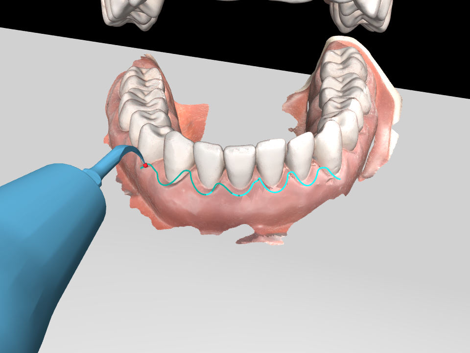

图：本次**完整验证轨迹**在第 12 秒的回放，青色为参考路径、红点为 TCP，不是接触证明。
候选模式使用同一查看器，但不查碰撞、不跑动力学，始终 `execution_ready=false`。
另一个参数 `--geometry-only` 仅导出几何、不生成 IK，不能替代 `--check-mode geometry_only`。

### 4.4 用所选角度完成规划与审计

```powershell
$prepared = "outputs/tutorial/manual/regions/outer_front"
$plan = "outputs/tutorial/front_full"
& $py -m planning --perception-result $prepared --region outer_front `
  --pose-angles-deg 6.37 13.26 -0.4 --planning-mode simple `
  --jaw-opening-deg 20 --standoff-mm 1.8 --pose-spacing-mm 0.25 `
  --joint-step-rad 1 --max-orientation-step-deg 30 `
  --speed-mm-s 1 --transfer-speed-mm-s 150 `
  --check-mode full --headless --out $plan
& $py -m planning.preview --plan $plan
& $py -m planning.view --plan $plan --speed 1
```

`full` 重新进行姿态搜索、完整工具/双颌网格与自碰撞检查、进出场、时序和实际动力学验收。
考虑碰撞后可能选择不同的 ±5° 修正，需检查 `pose_search_report.json` 和 `sweep_reference.json`。
复用完整 pipeline 时设置 `$plan = "$run/tracking"` 即可。

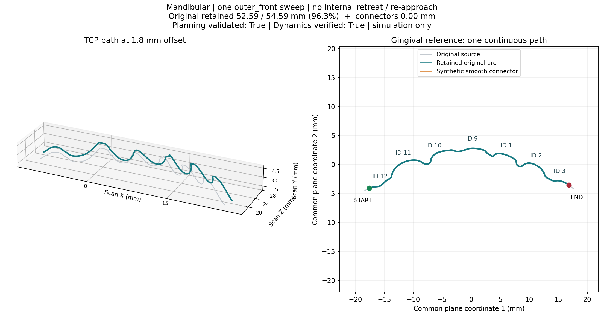

图：本例源线保留率约 96.34%，人工补线长度为 0；这是选区几何保留率，不是全口覆盖率、接触率或治疗完成度。
左图为离面 TCP 轨迹，右图为牙龈参考平面投影。

| 规划产物 | 关注内容 |
| --- | --- |
| `planning_report.json` | `execution_ready`、检查模式、误差、间隙与耗时 |
| `pose_search_report.json`、`pose_targets_world_m.npy` | 搜索诊断、实际目标姿态 |
| `trajectory.npz` | 带原始时序及插值信息的关节轨迹 |
| `trace_audit.json/.csv`、`dynamics_validation.json` | 独立 FK、姿态、运动和动力学验收 |
| `sweep_reference.json` | 连续参考及本次规划姿态策略 |
| `continuous_sweep.png/.svg` | `planning.preview` 静态诊断图 |

```powershell
& $py -m planning.view --plan $plan --time 12 --camera 10 --snapshot outputs/tutorial/tool_pose.png
& $py -m planning.view --plan $plan --speed 5 --fps 10 --gif outputs/tutorial/trajectory.gif
```

查看器只回放关节状态，不运行控制；`--speed` 只改变回放速度。
修改执行时长需要重新验收，见第 4.5.6 节的 `planning.retime`。
入门先使用主规划自动时长；直接在主规划中设置 `--duration` 会改变该入口的时序约束配置，不能等同于对已有轨迹做重计时。
详见 [planning](planning/README.md) 和 [motion_planning](planning/motion_planning/README.md)。

### 4.5 Planning 命令与参数文件速查

以下命令均在项目根目录运行，沿用第 1 节的 `$py`。每个命令可以单独使用，不要求顺序执行整张表。
主规划读取第 3 节生成的感知区域；其余轨迹命令读取规划输出目录。
只运行了第 2 节时，改用 `outputs/tutorial/full_front/regions/outer_front` 作为 `--perception-result`，
或直接用 `outputs/tutorial/full_front/tracking` 作为下游 `--plan`，无需重复执行感知。

| 模块命令 | 配置文件 | 输入与输出 |
| --- | --- | --- |
| `planning` | [planning_outer_front.json](config/planning_outer_front.json) | 感知区域 → 规划、审计与动力学验证结果 |
| `planning.visualization.pose_angles` | [planning_pose_angles.json](config/planning_pose_angles.json) | 感知区域或附带数据 → 浏览器姿态滑块与候选参数 |
| `planning.view` | [planning_view.json](config/planning_view.json) | 规划目录 → MuJoCo 回放、PNG 或 GIF |
| `planning.preview` | [planning_preview.json](config/planning_preview.json) | 规划目录 → 连续参考与 TCP 路径诊断图 |
| `planning.sweep_preview` | [planning_preview.json](config/planning_preview.json) | 规划目录 → 同一连续路径诊断图，直接调用绘图入口 |
| `planning.segment_map` | [planning_segment_map.json](config/planning_segment_map.json) | 规划目录 → 指定目录中的区域诊断图 |
| `planning.retime` | [planning_retime.json](config/planning_retime.json) | 已验证规划 → 新时序、新审计和动力学验证 |
| `planning.execute` | [planning_execute.json](config/planning_execute.json) | 已验证规划 → 位置控制仿真或复用已有动力学验收 |

#### 4.5.1 JSON 格式与覆盖规则

通用形式为 `& $py -m <模块命令> --params config/<配置文件>.json`。
优先级为 **内置默认值 < JSON 文件 < 显式命令行参数**；不指定 `--params` 时使用原有 CLI 默认值。
下表中的样例值来自对应 JSON，可能与不带配置文件时的默认值不同。

- JSON 顶层是对象，通常把 CLI 中的 `-` 换为 `_`，如 `--standoff-mm` 对应 `standoff_mm`。
- 三角度使用数组 `"pose_angles_deg": [6.37, 13.26, -0.4]`；布尔值使用 `true`/`false`，不写成字符串。
- 可选且未设置的参数可写 `null`；必填的 `plan`、`out` 可以只在 JSON 中提供，不能省略或设为 `null`。
- 文件内路径和 `--params` 文件路径相对于**项目根目录**，命令行传入的其他相对路径相对于**当前工作目录**；均可使用绝对路径。
- 每份文件只接受对应命令的参数；未知键、重复键、注释、非有限数字和错误类型会报错。
- 主规划和重计时必须使用新的空输出目录；回放、导图和执行则指向已经生成的规划目录。

布尔参数也能通过 CLI 反向覆盖：

| 文件中的设置 | CLI 覆盖示例 |
| --- | --- |
| `headless: true`、`execute: true` | `--no-headless`、`--no-execute` |
| `paused: true`、`original_timing: true` | `--no-paused`、`--no-original-timing` |
| `geometry_only: true`、`dry_run: true` | `--no-geometry-only`、`--no-dry-run` |
| `no_browser: true`、`no_output: true` | `--browser`、`--save-output` |

pipeline 的文件使用 `offset_mm` / `output`，独立 planning 使用 `standoff_mm` / `out`，不能直接混用。
主规划的单角度别名使用 argparse 实际字段名 `tilt_deg`、`tilt_azimuth_deg`、`fixed_roll_deg`，
推荐统一使用 `pose_angles_deg`；它不能与非默认的单角度设置混用，旧 `simple_angles_deg` 已停用。
各入口完整 CLI 列表可用 `& $py -m <模块命令> --help` 查看。

#### 4.5.2 主规划：planning

先检查参数，再进行完整规划；下游命令通过 `--plan` 指向这里的 `$plan`：

```powershell
$prepared = "outputs/tutorial/manual/regions/outer_front"
$plan = "outputs/planning/my_front"
& $py -m planning --params config/planning_outer_front.json `
  --perception-result $prepared --out $plan --dry-run
& $py -m planning --params config/planning_outer_front.json `
  --perception-result $prepared --out $plan
```

| JSON 参数 | 样例值或可选值 | 含义 |
| --- | --- | --- |
| `perception_result` | `outputs/tutorial/manual/regions/outer_front` | 保存的 `PreparedRegion` 目录或 `perception_region.json` |
| `region` | `outer_front` | 六区域之一，必须与感知结果一致；切区时同时更换感知目录 |
| `planning_mode` | `simple` / `continuous` | 区域固定姿态 / 局部牙面姿态 |
| `pose_angles_deg` | `[6.37, 13.26, -0.4]` | `[ANGLE, AZIMUTH, FLIP]`，单位为度 |
| `jaw_opening_deg` | `20` | 下颌张口角，单位为度；选角、规划、后续场景应保持一致 |
| `standoff_mm` | `1.8` | TCP 离面距离，单位为 mm；设为 0 不等于已经建立合法接触 |
| `pose_spacing_mm` | `0.25` | 姿态与 IK 采样间隔，单位为 mm；不改变感知曲线采样 |
| `joint_step_rad` | `1.0` | 相邻 IK 节点允许的最大关节变化，单位为 rad；插值审计仍会执行 |
| `max_orientation_step_deg` | `30` | 相邻目标旋转变化上限，单位为度 |
| `speed_mm_s` | `1` | 清扫 TCP 速度上限，单位为 mm/s |
| `transfer_speed_mm_s` | `150` | 进出场 TCP 速度上限，单位为 mm/s |
| `check_mode` | `full` / `geometry_only` | 完整验收 / 仅测试姿态和路径可达性；后者跳过碰撞，不能执行 |
| `orientation_audit` | `strict` / `diagnostic` | 姿态误差严格验收 / 仅记录诊断；入门保留 `strict` |
| `headless` | `true` | 隐藏交互窗口，仍进行实际动力学验证 |
| `execute` | `false` | 规划后调用位置执行入口；必须有可执行轨迹和持久输出 |
| `out` | `outputs/planning/outer_front` | 规划输出目录；例中通过 CLI 改为 `$plan` |

以下可选参数未全部写入样例文件，需要时再添加：

| JSON 参数 | 含义与使用条件 |
| --- | --- |
| `duration` | 正的目标总时长，单位为 s，包含进出场；省略时自动决定时长，指定后仍可能无解 |
| `dry_run` | 仅检查输入和配置，不运行 IK、碰撞或动力学 |
| `geometry_only` | 仅导出几何，在姿态搜索前停止；不同于 `check_mode="geometry_only"` |
| `no_output` | 在临时目录运行，结束后删除产物；不能与 `execute` 或 `dry_run` 同用 |
| `motion_mode` | `non-contact` / `contact`；后者要求 `standoff_mm=0`，不启用恒力控制 |
| `mount_position_mm` | 机器人安装位置 `[x, y, z]`，单位为 mm；修改后重新验证可达性和碰撞 |
| `speed_profile` | 当前仅支持 `local`，使用固定关节样条和 TOPPRA 局部降速 |
| `jaw` | `mandibular` / `maxillary`；显式指定时必须与感知结果一致 |
| `scan`、`topology`、`prediction_dir`、`regional_dataset` | 从原始扫描、线拓扑、匹配分割和六区数据准备感知区域的兼容入口；不能与 `perception_result` 混用 |
| `world_from_scan`、`sweep_trim_mm` | 原始输入预处理所用的米制配准矩阵 `.npy` 和整区端点裁剪量（mm）；已保存感知曲线的变换、裁剪应在 perception 阶段修改并重新导出 |

`geometry_only=true` 不能与 `check_mode="geometry_only"` 同用，这两种输出也都不能执行。
完整输出和验收字段见第 4.4 节；`--dry-run` 通过只表示输入与配置检查通过。

#### 4.5.3 角度滑块：planning.visualization.pose_angles

```powershell
& $py -m planning.visualization.pose_angles --params config/planning_pose_angles.json
# 使用自己的感知结果，并显示上下颌
& $py -m planning.visualization.pose_angles --params config/planning_pose_angles.json `
  --perception-result outputs/tutorial/manual/regions/outer_front --model-scope both
```

`perception_result`、`region`、`planning_mode`、`pose_angles_deg`、`standoff_mm`、`jaw_opening_deg`
决定初始姿态；`model_scope` 选择牙模范围，`port` 和 `no_browser` 控制本地服务。
所有字段、滑块操作及截图见第 4.2 节。这里生成的是候选姿态，不能直接作为轨迹执行。

#### 4.5.4 回放与图片导出：planning.view

```powershell
$plan = "outputs/planning/my_front"
& $py -m planning.view --params config/planning_view.json --plan $plan
# 覆盖配置中的 paused=true，直接开始播放
& $py -m planning.view --params config/planning_view.json --plan $plan --no-paused --speed 2
# 定位并导出截图，完成后退出
& $py -m planning.view --params config/planning_view.json --plan $plan `
  --time 12 --snapshot outputs/tutorial/selected_pose.png
# 导出整条轨迹的 GIF，完成后退出
& $py -m planning.view --params config/planning_view.json --plan $plan `
  --speed 5 --fps 10 --gif outputs/tutorial/selected_pose.gif
```

| JSON 参数 | 样例值或范围 | 含义 |
| --- | --- | --- |
| `plan` | `outputs/planning/outer_front` | 已生成的规划目录，必填；例中通过 CLI 覆盖 |
| `speed` | `1`，须大于 0 | 回放倍速；不改变保存的轨迹时序或执行速度 |
| `paused` | `true` | 打开后暂停，便于检查姿态；空格继续 |
| `time` | `null` 或秒数 | 从轨迹指定时刻开始；未指定时通常从起点开始，截图默认取中点 |
| `waypoint` | `null` 或从 0 开始的整数索引 | 定位路点并暂停；与 `time` 互斥，文件与 CLI 合并后也不能同时设置 |
| `camera` | `10`；可选整数 0–11 | 预设相机视角 |
| `distance` | `null` 或正数 | 相机距离，单位为 m；`null` 表示自动取景 |
| `snapshot` | `null` 或 PNG 路径 | 导出当前选定时刻截图并退出 |
| `gif` | `null` 或 GIF 路径 | 导出整条轨迹动画并退出；与截图分别运行 |
| `fps` | `10`；大于 0 且不超过 50 | GIF 帧率 |
| `jaw_opening_deg` | 可选，通常省略 | 默认恢复保存的张口角；覆盖值必须仍与已验证牙颌位姿一致 |

仅几何导出没有 `trajectory.npz` 时，不能使用时间定位、路点定位或 GIF 导出。
回放仅设置关节状态供观察，不运行控制器；执行见第 4.5.7 节和第 5 节。

#### 4.5.5 诊断图：preview、sweep_preview 与 segment_map

```powershell
$plan = "outputs/planning/my_front"
& $py -m planning.preview --params config/planning_preview.json --plan $plan
& $py -m planning.sweep_preview --params config/planning_preview.json --plan $plan
& $py -m planning.segment_map --params config/planning_segment_map.json `
  --plan $plan --out outputs/tutorial/selected_segment_map
```

| 命令 | JSON 参数 | 输出位置 |
| --- | --- | --- |
| `planning.preview` | `plan`，必填 | `$plan/continuous_sweep.png` 和 `.svg` |
| `planning.sweep_preview` | `plan`，必填；与 preview 共用配置 | 同上，当前六区域规划调用同一绘图实现 |
| `planning.segment_map` | `plan`，必填；`out` 指定导图目录 | `out/continuous_sweep.png` 和 `.svg`；样例 `out` 为 `outputs/planning/segment_map` |

这三个入口当前展示同一连续区域参考，包括离面 TCP 轨迹、平面投影、牙位、端点和源线保留统计。
前两个入口无需重复运行；需要另外保存一份图时使用 `segment_map`。
导图会更新目标位置的同名图片，不修改轨迹或重新运行规划、碰撞和动力学验证。

#### 4.5.6 独立重计时：planning.retime

读取已验证的固定关节路径，在新的输出目录重新生成时序并审计，不重新选择角度或搜索 IK：

```powershell
$plan = "outputs/planning/my_front"
& $py -m planning.retime --params config/planning_retime.json `
  --plan $plan --out outputs/planning/my_front_90s
```

| JSON 参数 | 样例值 | 含义 |
| --- | --- | --- |
| `plan` | `outputs/planning/outer_front` | 已验证的源规划目录，必填 |
| `out` | `outputs/planning/outer_front_90s` | 新的空输出目录，必填；不会自动替换后续命令的 `plan` |
| `duration` | `90` | 目标总时长，单位为 s，必须为正；不是回放倍速 |
| `trace_speed_mm_s` | `1` | 重计时清扫 TCP 速度上限，单位为 mm/s |
| `transfer_speed_mm_s` | `150` | 重计时进出场 TCP 速度上限，单位为 mm/s |
| `jaw_opening_deg` | 可选，通常省略 | 恢复保存的张口角；必须与源轨迹已验证场景一致 |

重计时保留源轨迹的关节速度、加速度和角速度上限，只调整时序及显式设置的 TCP 速度上限。
本轮干净环境中，上述前牙区轨迹的 **90 s 重计时已通过碰撞、运动审计和实际动力学验收**。
较短时长仍可能低于固定路径的可行下限，失败时不会放宽源运动限制。
新目录的 `planning_report.json` 必须显示 `execution_ready=true`，且通过加载校验，才能执行；
失败输出不可执行。修复前后的记录见 [README 命令验收](docs/integration/2026-11-11-readme-command-audit.md)。

```powershell
# 执行上面通过验收的重计时结果，保留它的 90 s 时序
& $py -m planning.execute --params config/planning_execute.json --plan outputs/planning/my_front_90s
```

#### 4.5.7 轨迹执行：planning.execute

默认示例使用已保存的原时序，避免自动重计时：

```powershell
$plan = "outputs/planning/my_front"
& $py -m planning.execute --params config/planning_execute.json --plan $plan
# 显示 MuJoCo 执行窗口
& $py -m planning.execute --params config/planning_execute.json --plan $plan --no-headless
```

| JSON 参数 | 样例值 | 含义 |
| --- | --- | --- |
| `plan` | `outputs/planning/outer_front` | 要加载的已验证规划目录，必填；使用重计时结果时显式改为新目录 |
| `headless` | `true` | 不打开交互窗口；已有符合条件的动力学验收时会复用结果 |
| `original_timing` | `true` | 使用保存的时序，不重计时；这是样例配置值，不带配置时 CLI 默认为 `false` |
| `duration` | `90` | 仅在 `original_timing=false` 时作为重计时目标总秒数 |
| `trace_speed_mm_s` / `transfer_speed_mm_s` | `1` / `150` | 仅在重计时时使用的清扫 / 进出场速度上限，单位为 mm/s |
| `jaw_opening_deg` | 可选，通常省略 | 恢复保存的张口角；不能用它随意改变已验收轨迹的场景 |

也可由执行入口自动完成“先重计时再执行”：

```powershell
& $py -m planning.execute --params config/planning_execute.json --plan $plan `
  --no-original-timing --duration 90
```

该模式会为通过验证的时序创建或复用带时长和指纹的派生规划目录，并打印 `Execution plan`；
不会覆盖源路径，重计时失败则停止，不进入执行；源运动限制和验收要求同第 4.5.6 节。
保持 `original_timing=true` 时，单独修改 `duration` 或重计时速度参数不会改变执行时序。

`planning.execute` 使用位置控制，恒力实验使用第 5.3 节的 `control.force`。
需要明确重复进行一次位置控制实验时，使用第 5.2 节的 `control.position`；
`planning.execute --headless` 复用已有动力学结果不表示又做了一次独立实验。
执行报告在最终选定的规划目录中；失败的重计时目录、候选姿态 JSON 和仅几何输出均不能执行。

## 5. 验证与执行轨迹

本节要求已有完整验收的规划目录。以下沿用第 4.5.2 节的输出；若使用完整 pipeline，改为其 `tracking/`：

```powershell
$plan = "outputs/planning/my_front"
# 或：$plan = "outputs/tutorial/full_front/tracking"
```

### 5.1 执行前加载校验

只加载检查，不执行控制：

```powershell
& $py -c "import sys; from control.position import load_verified; m,d,p,c=load_verified(sys.argv[1]); print('Verified duration (s):', p.duration)" $plan
```

加载器检查执行就绪状态、TCP/姿态约定、来源与轨迹指纹、审计、场景/牙颌/安装状态。
源模型或场景改变后重新生成轨迹；仅几何输出、旧格式或被修改的轨迹会被拒绝，不能手改报告为通过。

### 5.2 位置控制

```powershell
& $py -m control.position --plan $plan --headless
# 显示执行窗口时省略 --headless
```

也可在单独 planning 命令中加 `--execute`。完整 pipeline 已自动验证位置执行，独立入口用于重复实验。
控制器包含位置伺服、动力学前馈、实际碰撞和误差监测，不建立恒力闭环。
结果写到 `$plan/execution_report.json` 与 `execution_trace.csv`，重复执行会更新这两个执行文件。
检查状态、最大位置/旋转误差及最小实际间隙。关闭执行窗口记为 `interrupted`，不算通过。

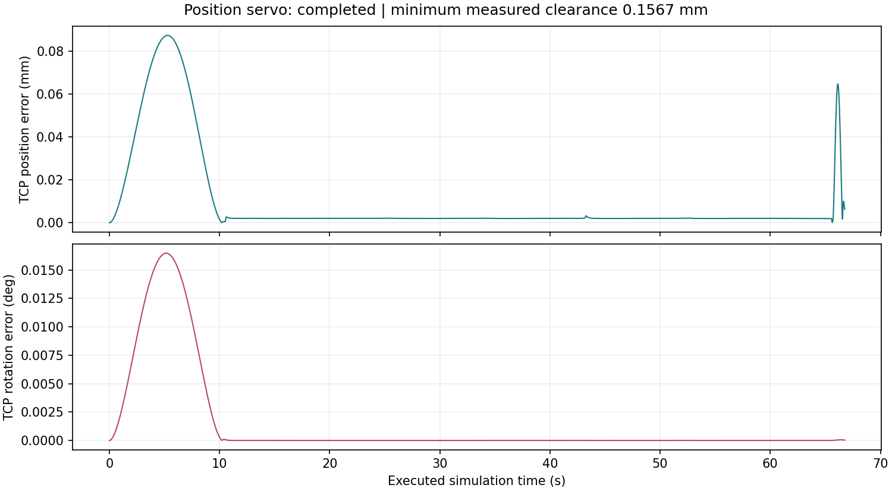

图：本次独立位置执行约 66.68 s，最大位置误差约 0.0873 mm、最大旋转误差约 0.0165°、最小实际间隙约 0.1567 mm。

### 5.3 恒力控制与接触核验

恒力是独立实验，读取已验证的完整规划目录，保留连续参考，通过法向导纳外环与位置内环调节接触合力。
默认 `auto` 对当前区域采用一次贴合、连续沿线、一次卸力；`segments` 为逐段实验，不是六区自动执行。
**此节是开发实验，不是安装或主流程成功检查。** 当前前区示例会按保护逻辑停止并返回退出码 2；
需要返回成功状态的控制组件检查时，使用本节末尾的球-平面 benchmark。

```powershell
& $py -m control.force --source $plan --out outputs/tutorial/force_front `
  --target-force-n 1 --contact-schedule regional `
  --trace-speed-mm-s 1 --max-duration-s 90
```

加 `--viewer` 打开 MuJoCo 和实时力面板。默认时限 60 s，应按轨迹、贴合/卸力及反馈降速设置足够时间；延长时限不豁免保护。
1 N 为仿真实验参数；`offset=0` 只定义几何目标，不保证合法工作端接触，规划仍检查完整网格。

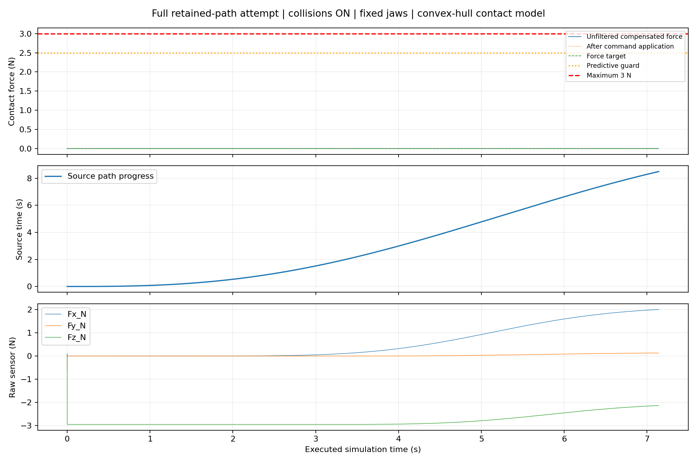

图：本次前区实验在约 7.141 s 因预测接触力达到 2.5 N 保护条件停止，**未通过恒力/原扫描牙面接触验收**。
MuJoCo 凸包接触代理与原扫描表面不一致，出现力信号不能单独证明接触目标牙面。

| 力控产物/字段 | 用途 |
| --- | --- |
| `trajectory_force.csv`、`trajectory_contacts.csv`（如有） | 补偿力、原始六轴、关节、阶段与接触日志 |
| `force_tracking.png` | 力、源轨迹进度和原始传感器信号 |
| `force_trajectory_report.json` | 状态、停止原因、峰值、路径进度和验收 |
| `contact_validation.json`、`scan_contact_audit.csv` | 独立力跟踪复算、实际关节对原扫描网格接触复查 |
| `force_tracking_passed` | 力跟踪是否通过 |
| `scanned_surface_contact_passed` | 原扫描牙面接触是否通过 |
| `force_control_passed` | 综合验收，false 时 CLI 返回 2 |

```powershell
# 控制器组件基准，不能替代牙面轨迹验收
& $py -m control.force.benchmark --target-force-n 1 --out outputs/tutorial/force_benchmark
```

当前前区恒力尚未通过，主流程位置控制通过不能解释为接触洁治通过。
详见 [力控模块](control/force/README.md) 和 [接触验证记录](docs/integration/2026-11-11-contact-force-validation.md)。

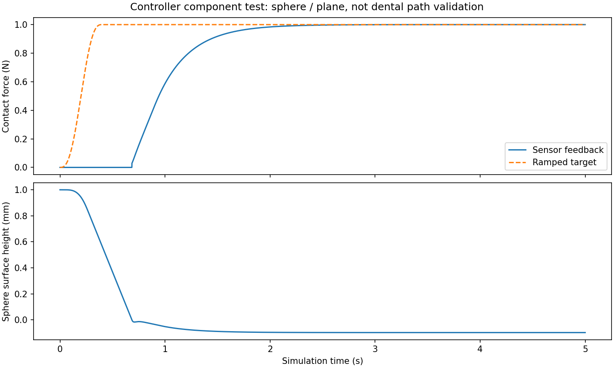

图：同一控制器在独立球-平面物理模型下闭环跟踪 1 N，末 1 s 平均约 0.999993 N，组件基准通过。
这不替代上面的六轴机械臂牙面接触验收。

## 6. 模块开发与回归验证

| 模块 | 接口/入口 | 开发位置 |
| --- | --- | --- |
| 仿真采集 | `capture_rgbd`、`save_capture` | `perception/global_camera.py`、`frames.py` |
| 牙龈线提取 | `extract_gingival_line`、提取 CLI | `perception/gingival_extraction/` |
| 配准 | `register_capture`、`register_clouds_automatic` | `perception/registration/` |
| 分割 | 预测校验 CLI、`load_prediction`、`clean_instances` | `perception/tooth_segmentation/` |
| 区域几何 | `prepare_regions`、`PreparedRegion.save/load` | `perception/regions/` |
| 姿态/IK | `planning.pipeline.run(PreparedRegion, ...)` | `planning/simple.py`、`pose_search/` |
| 避碰/时序/审计 | `python -m planning` | `planning/motion_planning/`、`infrastructure/` |
| 可视化 | `planning.visualization.pose_angles`、`planning.view`、`planning.preview` | `planning/visualization/` |
| 位置控制 | `load_verified`、`execute`、`GingivalTCPController` | `control/position/` |
| 恒力 | `control.force`、组件 benchmark | `control/force/` |
| 全流程组织 | `pipeline.run`、阶段报告 | `pipeline/stages/`、`tracking.py` |

planning API 只接受 `PreparedRegion` 或其保存路径；拟合、裁剪和牙位归属属于 perception。
模块通过产物、单位与指纹交接，修改算法后先验证本模块，再运行下游。
真实 D405 使用 [真实相机指南](perception/REAL_CAMERA.md)；真实机器人后端当前为传输接口预留，以上命令仅执行仿真。

```powershell
& $py -m unittest discover -s tests -p 'test_*.py' -q
& $py -m unittest discover -s planning -t . -p 'test_*.py' -q
& $py -m pipeline.run --params config/pipeline_outer_front.json --dry-run
```

| 常见问题 | 检查/处理 |
| --- | --- |
| TOPPRA 编译失败 | 检查 Python x64、MSVC 和 SDK，按锁文件安装 |
| 模块导入失败 | 在根目录用 `$py -m ...`，不要直接运行子目录 `.py` |
| 输出目录不为空 | 换新目录，保留原验收结果 |
| 扫描/分割/六区不匹配 | 换成配套数据，不绕过来源检查 |
| 自动配准失败或错位 | 检查 ROI、深度、点数和牙位，独立调参或人工配准 |
| 可达预览成功、full 失败 | 查姿态报告、`failure.json` 和审计，重新选角/离面距离 |
| `FailUncontrollable` 或指定时长失败 | 先复现自动时长，再研究时序约束 |
| 轨迹加载报来源/牙颌变化 | 按当前场景重做感知与规划 |
| 力控返回 2 | 查停止原因及独立验收字段，不能只看平均力 |

## 7. GitHub 发布准备与当前验收

提交代码、配置、依赖文件，以及运行必需的 `assets/simulation/`、彩色扫描、`assets/perception/` 和 `assets/regional_paths/`。
保留机器人资产附带的许可证。`.gitignore` 已排除环境、`outputs/`、缓存和本地 `.env`；
本页图片保存在 `docs/images/`，克隆后可直接显示。
`.gitattributes` 保留资产原始字节，避免 Git 的换行转换破坏来源哈希校验；请保留此文件。

口扫、分割及源 CAD 的公开授权和去标识情况需由数据所有者确认；根目录尚未声明项目许可证。
提交前检查 `git status --short`、`git diff --check`，避免漏掉新增模块或资产。工作区包含资产迁移，不能只提交 README。

2026-11-11 最新干净环境、逐项命令及重计时修复结果见 [README 命令验收](docs/integration/2026-11-11-readme-command-audit.md)，
之前的流程审计见 [发布前检查记录](docs/integration/2026-11-11-pre-github-review.md)，
真实输出图片的来源及重建方法见 [图片说明](docs/images/README.md)。
仅下颌 `outer_front` 的上述参数完成本轮端到端验收，其余区域、真实相机与实机需分别验证。
