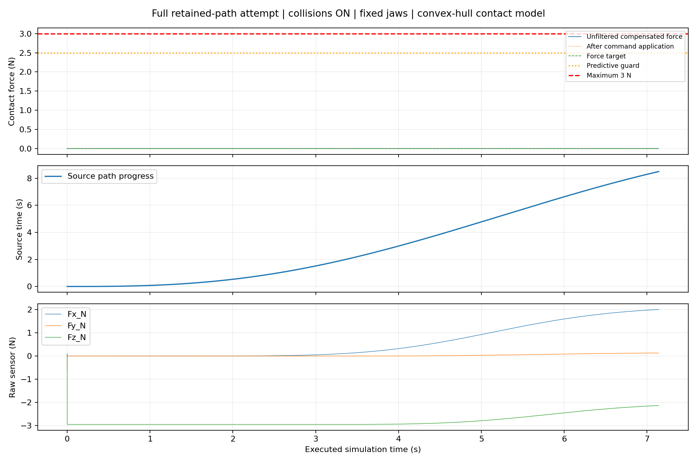
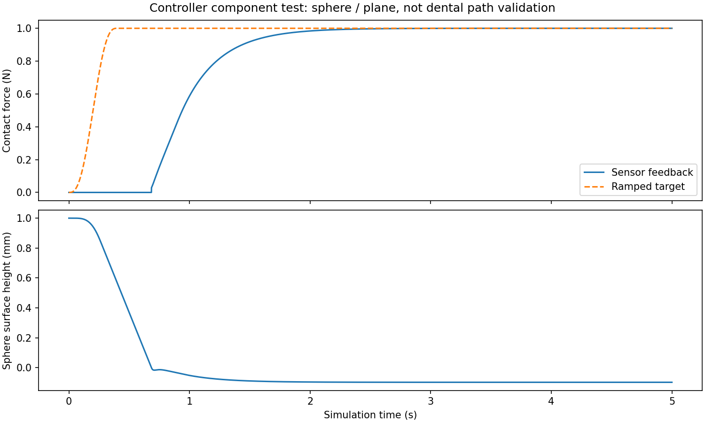

# Force Control

The force stage contains the compliant contact configuration, predictive force
guard, contact-path runner, force history, and force-panel visualisation. The
implementations live together in this subpackage; `runner.py` is the stable
command-line boundary.

Run `python -m control.force --source <verified-tracking-directory> --out <empty-directory>`.
Trajectory execution is the default; explicit `--mode trajectory` is also accepted.
`--source` is required, so no historical output is selected implicitly. The old
segmented-plan probe CLI and `--sweep-mm` option have been removed. Shared collision
checks, signal logging, and the isolated stop-behavior test probe remain in
`contact_experiment.py`.

Continuous regional sources now default to one acquisition and one uninterrupted
regional force-controlled trace. `--contact-schedule segments` retains the older
per-arc acquire/release experiments. Regional execution preserves the saved
geometry and orientation policy; it does not reconstruct the perception path.

Every full-path run also audits the saved sensor log and replays measured joints
against the original scanned triangle meshes. Force tracking alone cannot pass
`force_control_passed` when the physical convex proxies are still separated from
the scanned tooth surface. See the [current validation](../../docs/integration/2026-11-11-contact-force-validation.md).

`python -m control.force.benchmark --out <empty-directory>` runs a separate 1 N
sphere/plane controller component test, not a dental trajectory certification.

The documented front-region attempt stopped at 7.141 s on the 2.5 N predictive
guard, before cleaning started. It did not pass dental contact validation.

The sphere/plane benchmark passes independently. See the [project guide](../../README.md)
for commands, output fields, and the distinction between these acceptance results.
