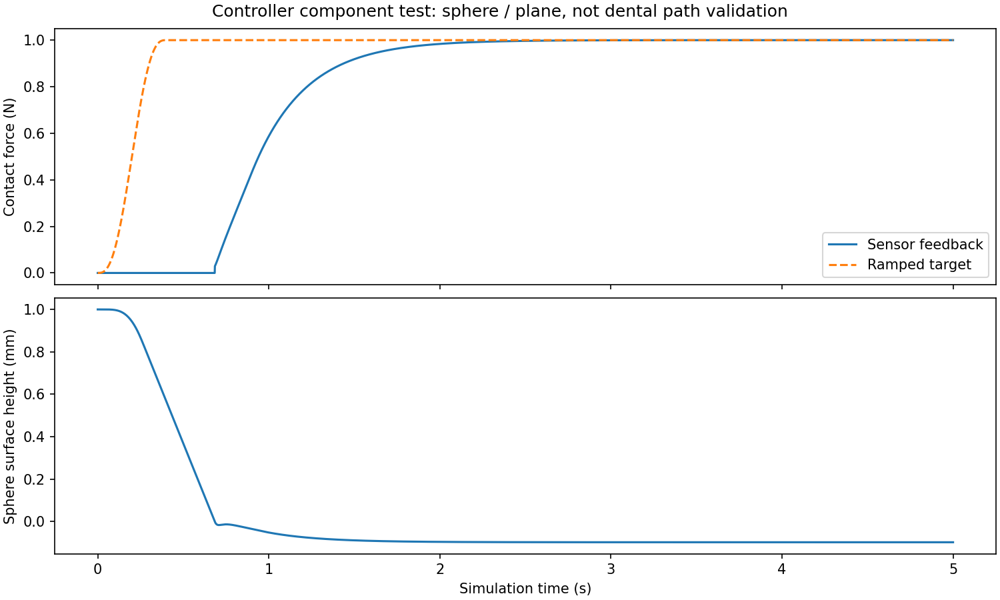

# Force Control

## 当前开发入口：前区法向恒力

新入口复用已验证的位置规划，控制 **补偿后的有符号牙面法向力**，总合力仍用于保护。
默认配置为 `config/force_outer_front.json`，来源是 0° 前区规划、姿态 `[50,0,50]`。
名义轨迹的 1.8 mm 离面距离保持不变，力控只叠加受限法向修正；源曲线及规划文件不改写。
以下只用于 MuJoCo 仿真，不连接另一个 ROS 工程，也不发送真实机器人指令。

**当前开发状态（2026-11-14）：**默认改为局部工作带接触层，旧整牙 CoACD 仅通过
`--method coacd` 显式选择，失败不会自动回退。实际资产在
`assets/contact/outer_front_local/`，仍是厚度 0.5 mm 的历史失败版本。
新配方使用 0.05 mm 厚度，先预检工具再构建牙面；本次真实重建输出
`assets/contact/outer_front_local_geometry_v2_20261114/`，状态为 `failed_geometry_gate`：
工具尖端原面 2660、2889 是绕序相反的重合面，构成零体积组件，无法确认向内挤出方向。
预检立即停止，未生成牙面分块，也未启动动态实验。
后续单牙尝试可用 `--scope first_tooth_hold`：仅选 12 号牙的原规划起点。
在用户接受 0.0015 mm 差异后，碰撞副本还剔除了到原面距离仅约 0.000105 mm 的
2392 号面；三处合计最大差异仍约 0.001469 mm。
`assets/contact/tooth12_hold_20261114_e/` 已生成 2540 个小块，但牙面、工具的组合射线
与边界检查仍未全部通过，状态为 `failed_geometry_gate`，单点 hold 尚未运行。
继续用原规划起点的实际工具扫掠包络复核后，`assets/contact/tooth12_hold_20261114_h/`
通过静态与加载检查。实际 hold 在约 0.755 s 接触后，预测保护因工具尖端将接触未标记
原网格面 164151 而停止，未达到 5 s；运行及独立审计见
`outputs/control/force/tooth12_hold_20261114_h2/`。
详见[单牙尝试](../../docs/integration/2026-11-14-tooth12-hold-attempt.md)。
因此单点、短段、完整前区都未获得牙面恒力验收，阶段入口会停止并保存证据。
组件接缝测试通过不能替代实际工具和牙面的验收。详见新目录的
`geometry_failures.json`、`failed_source_faces.npz` 以及
[本次诊断](../../docs/integration/2026-11-14-force-contact-preflight.md)。

```bash
conda activate rl
python -m pip install -r requirements-force.txt

# 先验证控制器组件，不等于通过牙面接触验收
python -m control.force.benchmark --target-force-n 1 --out outputs/control/force/my_benchmark

# 离线构建接触资产；必须返回 verified，不能手改状态绕过几何门槛
python -m control.force.contact_assets \
  --source outputs/planning/outer_front_aligned0_20261112_201022 \
  --method local_surface --out assets/contact/outer_front_local_NEW

# 按顺序执行；任一阶段失败后停止，输出目录自动使用时间戳
python -m control.force.stages --params config/force_outer_front.json --viewer
# 新生成的资产可覆盖配置路径，无需修改规划
# python -m control.force.stages --params config/force_outer_front.json \
#   --contact-model assets/contact/outer_front_local_NEW/manifest.json --viewer

# 单独运行时，short / regional 必须显式提供上一阶段通过报告
python -m control.force --params config/force_outer_front.json --stage hold --viewer
python -m control.force --params config/force_outer_front.json --stage short \
  --previous-stage outputs/control/force/outer_front/HOLD_RUN/force_trajectory_report.json --viewer
python -m control.force --params config/force_outer_front.json --stage regional \
  --previous-stage outputs/control/force/outer_front/SHORT_RUN/force_trajectory_report.json \
  --target-force-n 1 --force-tolerance-n 0.5 --viewer

# 合成平面面片/网格探针的压入和跨接缝组件回归（不代表牙面通过）
python -m control.force.local_benchmark --out outputs/control/force/seam_NEW
```

目录必须不存在或为空。单次实验默认位于 `outputs/control/force/outer_front/<时间戳>/`，
顺序实验位于 `outputs/control/force/local_front/<时间戳>/`，包含资产核验副本、
`stages_report.json` 和逐阶段结果。几何失败时保留失败状态，不生成虚假的力曲线或运动日志。
`--source` 可覆盖配置中的规划目录，但接触资产与源规划哈希必须匹配，换源后需重新构建。
首次实际实验不要跨过单点、短段阶段。原 `--source/--out` 命令仍可调用；
未指定已核验接触资产时属于旧凸包诊断，不能得到新的整区通过结论。

已通过的 12 号牙单点实验可直接回放接触过程，无须重新计算力控或碰撞：

```bash
/home/wangyahong/anaconda3/envs/rl/bin/python -m control.force.replay \
  --run outputs/control/force/tooth12_crown_163647_hold_20261115_g
```

回放默认从首次接触前 1 秒开始，按现实时间 **1 倍速**播放，到卸力结束后暂停。空格暂停/继续，`R` 重播，`+`/`-` 调速，`H` 显示/隐藏黄色力传感器外壳。红色小点是**已记录的接触坐标**，右侧力值也来自实验日志；回放不执行物理步进，不产生新的验收结果。

验收门槛改动后，可对已有日志复审，不必重跑仿真：

```bash
/home/wangyahong/anaconda3/envs/rl/bin/python -m control.force.validation \
  --run outputs/control/force/tooth12_line_2mm_short_20261116_5n
```

12 号牙局部短段的牙龈线接触带放宽到 1.05 mm；实际尖端弧长至少 1.5 mm。

| 文件 | 职责 |
| --- | --- |
| `contact_assets.py`、`local_assets.py` | 方法选择、局部牙面和实际工具 STL 接触资产生成、原面编号与指纹 |
| `local_surface.py`、`local_checks.py` | 同标签网格邻接分片、向内加厚、双向距离、正向/斜向/接缝/边界射线及覆盖完整性 |
| `contact_model.py` | 验证资产与源规划指纹，创建独立接触场景，读取显式物理参数 |
| `scan_guard.py` | 每个执行及预测状态检查完整原网格，并核对接触距离、法向、目标牙及尖端范围 |
| `stages.py`、`stage_gate.py` | 单点→短段→整区门控，核对上一阶段源规划、接触资产、材料和独立审计指纹 |
| `compliance.py` | 六轴无接触模型补偿、力分解和法向导纳 |
| `contact_path.py`、`continuous_path.py` | 稳定贴合、失力暂停、沿线和卸力；单点与短段沿访问过的前缀退出 |
| `force_guard.py`、`motion_guard.py` | 合力限值、独立预测拒绝、错误法向与无实际运动保护 |
| `force_servo.py` | 法向偏置的有界 IK 与现有位置执行器内环 |
| `validation.py` | 从 CSV 向量独立复算法向力，100 Hz 原口扫网格接触复查及输入指纹检查 |
| `runner.py` | JSON 参数与命令行覆盖；`force_panel.py`、`force_plot.py` 负责显示 |

### 接触模型与材料的含义

`local_surface` 从完整原曲线的 0.25 mm 采样计算保守覆盖半径：
1.8 mm 名义离面 + 3 mm 法向修正 + 3 mm 工作端半径 + 1 mm 边界余量 = 8.8 mm。
包含所有与该带相交的有标签原三角面，非选中牙齿只作为禁止接触障碍。
同牙齿、共享完整边的相邻面才允许合并；非流形边和凹轮廓不合并。
初始约 1 mm，按需细分到 0.25 mm，沿局部外法线反方向加厚 0.05 mm，
原面顶点保留。凸体工作面到原面及反向距离均需 ≤0.05 mm，否则记录失败。
工具接触面来自实际 `end_scaler.stl` 及原 geom→body 变换，未替换成球体。
工具深度取 `min(0.05 mm, 0.4 × 实测壁厚)`；绕序先沿流形邻接统一，封闭组件
再用带符号体积确认朝外，开放扫描保留原始种子绕序。零体积组件或未测得壁厚时失败。

工作面、底面、侧面逐面区分。工作面距离合格还不足以加载：原面法向、实际接近方向、
相邻 ±15° 斜向均检查首次接触，并采样三角边两侧和标签/开放边界外侧；
首次命中位置差和原面距离均需 ≤0.1 mm；接触法向偏差只记录，不作为门槛。
侧面/底面按同一距离条件判定，仍保留面类型记录；新增填隙继续失败。
遮挡、起点位于原面背侧、带外首命中和参考缺失分开记录，失效探针尝试缩短距离重采。
零有效样本或必检原面缺少正向覆盖不能通过。静态比较使用同射线的原面首命中作参考，
运行时在该分块的原三角面上用双精度计算接触距离，避免薄长三角面的浮点误判。
加载时重新计算几何检查，核对原扫描、工具、标签、规划指纹以及工作带覆盖。
接触策略版本写入 manifest；旧策略资产需重新构建，不能只改通过状态。
这些是有限采样检查，不能当作全局连续几何证明。

局部层仅在实际工作端与目标牙面之间启用物理接触；关闭原目标牙模和原工具整凸包接触。
惯量、TCP/六轴传感器坐标、可视模型保留。`scan_guard` 在每个实际及预测状态对原始
完整机器人/工具和双颌扫描检查；超过 0.1 mm 穿透、非尖端/非目标牙接触、
越出工作带、接触距离或法向不合格立即停止。不能因未生成某处局部层而忽略碰撞。

旧 CoACD 保留其封口和 120 s 单网格预算，仅作为显式选项，不参与自动回退。
原 `assets/contact/outer_front/` 和历史失败记录不覆盖。

当前物理覆盖仅为局部工作带；未标记的软组织不属于已核验的物理接触模型，
实际关节状态仍需原口扫完整网格复查。该版本不能据此宣称真实牙龈或软组织接触通过。

物理参数独立放在 `config/force_contact_material.json`：`solref`、`solimp`、`friction`、
`margin_mm` 均显式记录，默认沿用既有数值且 margin 为 0。
`status=uncalibrated` 表示没有实测材料标定；改变外观颜色不会改变接触物理。
每次保存实际加载的参数到 `contact_material_used.json`，报告记录来源指纹。

### 反馈、阶段和验收字段

`F_world = R_world_sensor @ (F_unloaded - F_sensor)`；
`Fn = dot(F_world, n_world)`，`Ft = norm(F_world - Fn*n_world)`。
`--force-component normal` 为新默认值；`resultant` 显式保留旧合力实验。
负法向力超过 0.05 N 作为符号错误停止，不能用绝对值掩盖。
传感器向量用于闭环，求解器接触力仅用于独立对照。

默认稳定保持 0.5 s 后才允许沿线运动，失力后暂停并重新稳定；获取接触限时 15 s。
低于 5 N 时继续把法向力拉回 0.5–1.5 N，不提前卸力。预测下一步达到 5 N，或实测总合力达到 5 N，才停止。
法向速度上限 2 mm/s，行程 ±3 mm；不为“跑完路径”自动放宽。
单点、短段和整区的目标都是 1 N，允许在 0.5–1.5 N 之间浮动。完整区域时限 300 s。

- `hold`：起点稳定恒力 5 s，再卸力并沿进场前缀返回。
- `short`：原参考前 5 mm，平滑停止、卸力并沿已走前缀返回。
- `regional`：保留整条区域参考，一次贴合、连续沿线、一次卸力并按原退出段撤离。

`trajectory_force.csv` 保留原合力字段，新增 `regulated_force_N`、有符号 `normal_force_N`、
`tangential_force_N`、世界坐标力向量和控制法向；CSV 不降采样。
`stage_passed` 只评价当前实验阶段；只有 regional 阶段同时通过力跟踪、接触资产门槛、
原网格接触核验和整区覆盖，`force_control_passed` 才能为 true。短段成功不能被当作整区成功。
CLI 当前阶段通过返回 0，保护停止、资产门槛失败或验收失败返回非零。

沿线要求：法向力保持在 1 ± 0.5 N，至少 95% 的采样落在这个区间，RMSE ≤ 0.5 N。短暂低于 0.5 N 仍记为失力，但只要不超过 5% 的采样，就不单独否决本阶段。
切向跟踪误差 ≤ 0.3 mm、姿态误差 ≤ 1°。原网格工作端接触距离和穿透均不超过 0.1 mm。
组件基准、源位置规划通过，都不替代这些验收。

```bash
python -m unittest tests.test_local_surface tests.test_force_normal tests.test_force_stages tests.test_compliance \
  tests.test_contact_path tests.test_contact_sweep tests.test_force_cli \
  tests.test_regional_force_validation tests.test_force_panel -v
```

## 原有接口与历史实验

The force stage contains the compliant contact configuration, predictive force
guard, contact-path runner, force history, and force-panel visualisation. The
implementations live together in this subpackage; `runner.py` is the stable
command-line boundary.

Run `python -m control.force --source <verified-tracking-directory> --out <empty-directory>`.
Trajectory execution is the default; explicit `--mode trajectory` is also accepted.
`--source` is required, so no historical output is selected implicitly. The old
segmented-plan probe CLI and `--sweep-mm` option have been removed. Shared collision
checks, signal logging, and the isolated stop-behavior test probe remain in
`contact_experiment.py`.

Continuous regional sources now default to one acquisition and one uninterrupted
regional force-controlled trace. `--contact-schedule segments` retains the older
per-arc acquire/release experiments. Regional execution preserves the saved
geometry and orientation policy; it does not reconstruct the perception path.

Every full-path run also audits the saved sensor log and replays measured joints
against the original scanned triangle meshes. Force tracking alone cannot pass
`force_control_passed` when the physical convex proxies are still separated from
the scanned tooth surface. See the [current validation](../../docs/integration/2026-11-11-contact-force-validation.md).

`python -m control.force.benchmark --out <empty-directory>` runs a separate 1 N
sphere/plane controller component test, not a dental trajectory certification.


The documented front-region attempt stopped at 7.141 s on the 2.5 N predictive
guard, before cleaning started. It did not pass dental contact validation.



The sphere/plane benchmark passes independently. See the [project guide](../../README.md)
for commands, output fields, and the distinction between these acceptance results.
