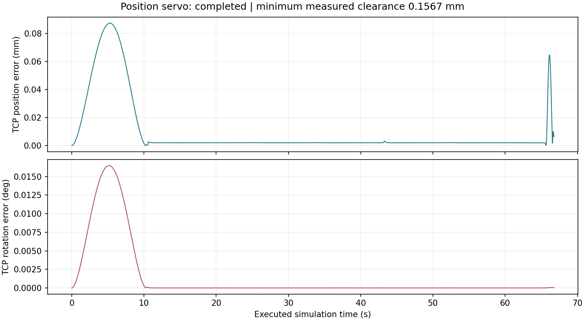

# Position Control

The position stage executes a validated `planning.infrastructure.trajectory.Trajectory` in
MuJoCo with collision checks, tracking error limits, and deterministic logging.
The public entry points are `GingivalTCPController`, `execute`, and
`load_verified`.

Run a verified simulation with `python -m control.position --plan <directory>
--headless`. A hardware backend can consume the same trajectory through the
protocol in `control.hardware`.

Both current planning modes (`simple` and `continuous`) use the same verified
loader. Saved timing is preserved; execution refreshes `execution_report.json`
and `execution_trace.csv` in the plan directory.

This non-contact mandibular example completed in simulation. Full installation,
module commands and acceptance criteria are in the [project guide](../../README.md).
