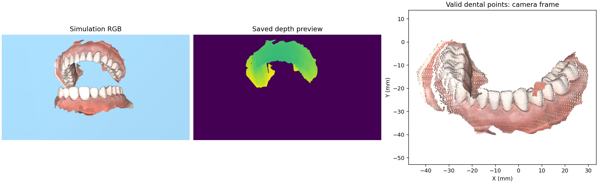
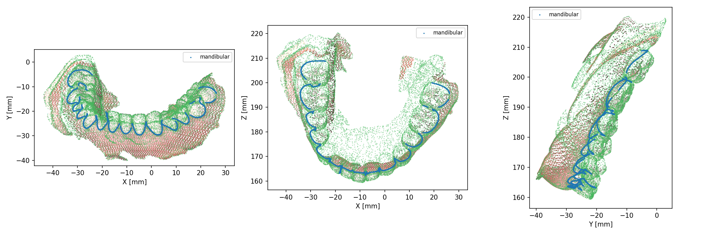

# 感知模块 Perception

本目录负责把口扫、相机点云和牙龈源线转换为配准结果、连续区域及可供规划使用的坐标数据。
本文件是感知总入口；各分类目录保留自己的算法、参数和接口说明。

| 要了解的内容 | 文档 |
| --- | --- |
| 点云配准算法与参数 | [配准说明](registration/README.md) |
| 真机人工选点、PLY 输入与外参接口 | [人工配准说明](registration/MANUAL_REAL.md) |
| 相机采集、数据格式、回放与评价 | [真机详细指南](REAL_CAMERA.md) |
| 彩色口扫牙龈线提取 | [牙龈线说明](gingival_extraction/README.md) |
| 单牙预测校验与处理 | [牙齿分割说明](tooth_segmentation/README.md) |
| 连续区域与规划交接 | [区域路径说明](regions/README.md) |

## 模块架构

`registration` 负责相机点云与口扫对齐，记录方法、对应点、变换、输入指纹和残差；
`gingival_extraction` 从彩色口扫提取点及边拓扑；`tooth_segmentation` 验证已有预测、
清理实例、传播牙齿标签并提取逐牙弧线。它们是不同阶段，可独立运行或测试。

`regions` 是区域几何的统一实现位置，负责牙齿归属、牙面平面、曲线拟合、整体端点裁剪和
源线连续性，输出 `PreparedRegion` 及 `perception_region.json`。该模块不依赖规划或控制，
规划读取既有区域，不重新构建牙龈曲线。不同区域不会自动连接，也不跨缺口补线。
冻结区域数据中的历史相机变换只用来还原口扫局部坐标；本次采集的位置由新配准独立确定。

阶段间通过明确的文件和数据类交接。口扫、网格及拓扑的长度单位为毫米，
规划使用的连续位置和世界/基座变换为米；配准矩阵的单位以输出字段或文件名为准。
指定输出目录后，各阶段保存 JSON 报告及相应数据、预览，整体运行的保留策略由调用方管理。

## 两条运行流程

以下命令在项目根目录运行；本机先执行 `conda activate rl`。

**独立仿真感知**（不执行机械臂规划或运动）：

```bash
python -m perception.simulation
```

牙龈线提取 → MuJoCo 采集 → 自动配准 → 相机坐标 → 世界坐标 → 区域路径准备。
用 `--view` 查看最终配准叠加，用 `--out` 指定空目录。与完整 pipeline 共用原有感知算法，
当前提供下颌区域快照及待核对的上颌六区候选源线；其他口扫仍需匹配的区域源线和分割预测，缺失会明确失败。
仿真使用 `T_world_camera × T_camera_scan`，世界坐标不等于机器人基座坐标。

**真机感知**（默认人工选点）：

当前真机入口不再在启动时依赖已删除的旧标定模块，可直接使用采集与人工配准；
旧 `calibrate` / `--calibration` 功能仍不可用，具体状态见 [真机详细指南](REAL_CAMERA.md)。

```bash
python -m perception.real manual --source sample --view
python -m perception.real manual --source ply --units mm --frame cv --view
python -m perception.real manual --source camera --view
```

`sample` 使用原 `4.ply` 历史样例；`ply` 弹窗选择现存文件，也支持 `--camera 路径`；
`camera` 连接 D405，先预选 ROI、预览并保存 PLY，再人工选点和 ICP。
口扫通过 `--scan` 指定；牙龈路径通过 `--line` 导入。矩阵和路径文件必须对应同一口扫。
原 `python -m perception.registration.manual_real` 命令保留，使用同一实现。

外参由其他标定流程提供，通过 `--extrinsics` 显式导入：

```bash
python -m perception.real manual --source sample \
  --line assets/perception/mandibular/gingival_line_points.csv \
  --extrinsics config/camera_to_base.example.json --view
```

`T_base_camera` 为 CV 相机到基座变换，平移单位米；与配准矩阵统一为米后组成
`T_base_scan = T_base_camera × T_camera_scan`。相机装在末端，外参必须对应**拍摄时的机器人姿态**。
示例为单位矩阵，占位结果使用 `_placeholder` 文件名和状态标记；替换实测矩阵后设置
`status=measured`。无外参时只输出相机坐标。本次接口不计算标定、不通信机器人、不执行运动。
详见 [人工配准接口](registration/MANUAL_REAL.md)。

## 代码分别负责什么

根目录的 Python 文件按职责分为入口、流程组织、公共数据/坐标和路径支持；
各算法分类保留在子目录中。文件位于根目录并不表示没有用途。

| 代码 | 职责 |
| --- | --- |
| **入口** `simulation.py` | 独立仿真入口，复用现有感知流程并显式导出坐标链 |
| **入口** `real.py` | 真机主入口：人工流程、采集、回放、评价等子命令 |
| **流程** `workflow.py` | 完整仿真感知组织，输出运行时结果和 PreparedRegion |
| **流程** `regional_registration.py` | 为六区域数据组织新的仿真采集配准 |
| **公共数据** `global_camera.py` | 仿真采集及现有公共配置、点云读写、输入指纹 |
| **公共坐标** `frames.py`、`artifacts.py` | 坐标/单位转换、外参加载、矩阵组合及结果导出 |
| **数据契约** `contracts.py` | 可序列化的感知结果契约；与 workflow 的运行时数据类职责不同 |
| **路径支持** `gingival_line.py` | 点/边拓扑排序，配准后的连续段与世界坐标路径 |
| **路径支持** `regional_paths.py` | 读取冻结的六区域源线，用历史变换还原口扫局部坐标；不拿历史位姿充当新配准结果 |
| **兼容接口** `tooth_instances.py` | 转发牙齿分割算法接口，兼容旧导入路径 |
| `registration/manual_real.py` | 样例/已有 PLY/相机三种输入的共享人工配准实现和兼容命令 |
| `acquisition/` | D405 设备与 RGB-D 帧、ROI、真实点云及元数据保存 |
| `registration/` | 人工对应点、刚体初始化、自动 FPFH/RANSAC、ICP、配准与评价报告 |
| `gingival_extraction/` | 彩色口扫牙龈边界提取、颜色噪声清理与内外侧筛选 |
| `tooth_segmentation/` | 读取验证已有 CrossTooth 预测，整理单牙标签和牙弓信息；不负责相机图像语义分割 |
| `regions/` | 区域连续曲线、单牙归属、牙面法向和整体端点裁剪，供规划消费 |

旧固定外置相机标定链路与当前末端相机流程应区分。当前流程通过 `--extrinsics` 导入外部
最终矩阵；旧 `calibrate` / `--calibration` 接口的背景和限制留在真机详细指南中。

## 结果放在哪里

`outputs/` 保留在项目根目录，不放到 `perception/` 源码内：

```text
outputs/perception/
├── simulation/<时间戳>/
│   ├── extraction/、capture/、registration/、regions/
│   ├── transforms/                 T_camera_scan_m、T_world_camera_m、T_world_scan_m
│   ├── paths/                      相机/世界坐标路径及元数据
│   └── run_report.json
└── real/<时间戳>/
    ├── capture/                    仅相机采集模式生成
    ├── registration/               人工点、ICP、配准点云与报告
    ├── transforms/                 米制矩阵、实际外参副本和元数据
    ├── paths/                      提供 --line 时生成路径 CSV
    └── run_report.json
```

每次新建带微秒的时间戳目录，显式 `--out` 必须不存在或为空。
`transforms/metadata.json` 和 `paths/metadata.json` 记录坐标系、米制单位、文件哈希、
外参来源/状态及输出清单。历史 `outputs/manual_real/`、`outputs/pipeline/` 不移动，
完整 pipeline 的输出仍由 pipeline 管理。
导出的点 CSV 不重新定义连通性；仿真继续保留 `extraction/` 的拓扑和 `regions/` 的独立区域，
不能仅按 CSV 行号跨缺口连线。

规划交接的区域数据使用相对路径：`perception_region.json` 的源文件、`geometry.json` 的
源文件指纹路径和 `perception_regions.json` 的区域索引都以各自 JSON 所在目录为基准，
并声明 `path_base: "manifest"`。换机时一起复制项目资产和结果、保持相对目录结构即可；
无需保持原用户名或桌面绝对路径。仅复制一个 JSON 文件不包含其依赖数据。
旧绝对路径格式仍支持在原位置读取，细节见 [区域路径说明](regions/README.md)。

## 现有内部接口

仿真主接口是 `perception.workflow.perceive_gingival_line`，其运行时 `PerceptionResult`
包含配准目录、采集和提取目录、拓扑路径、已变换路径、区域结果与清单。
其中 `paths.world_from_scan` 为口扫到世界的米制变换。`contracts.py` 中同名数据类用于
可序列化结果契约，不能将两个数据类视为可以直接互换。

独立导出区域后可交给规划：

```bash
python -m perception.regions --out outputs/perception/my_regions
python -m planning --perception-result outputs/perception/my_regions/outer_front --out outputs/planning/my_front
```

第二条命令属于规划模块，仍需通过相应运动检查。区域数据必须与颌别、口扫和分割预测指纹
匹配，缺失时不回退到旧的提取拓扑。`--world-from-scan` 可附加本次米制配准变换；
裁剪只作用于完整区域端点，不逐牙裁剪或添加连接桥。详细参数见分类文档，
历史调整背景见 [六区域整理记录](../docs/integration/2026-11-11-six-region-cleanup.md)。

真机的 `capture`、`recrop`、`register`、`checkpoints`、`evaluate` 和 `repeatability`
用于采集、已保存几何重裁剪、回放、检查点与重复性评价；数据格式及适用范围见
[真机详细指南](REAL_CAMERA.md)。

## 仿真结果示意




