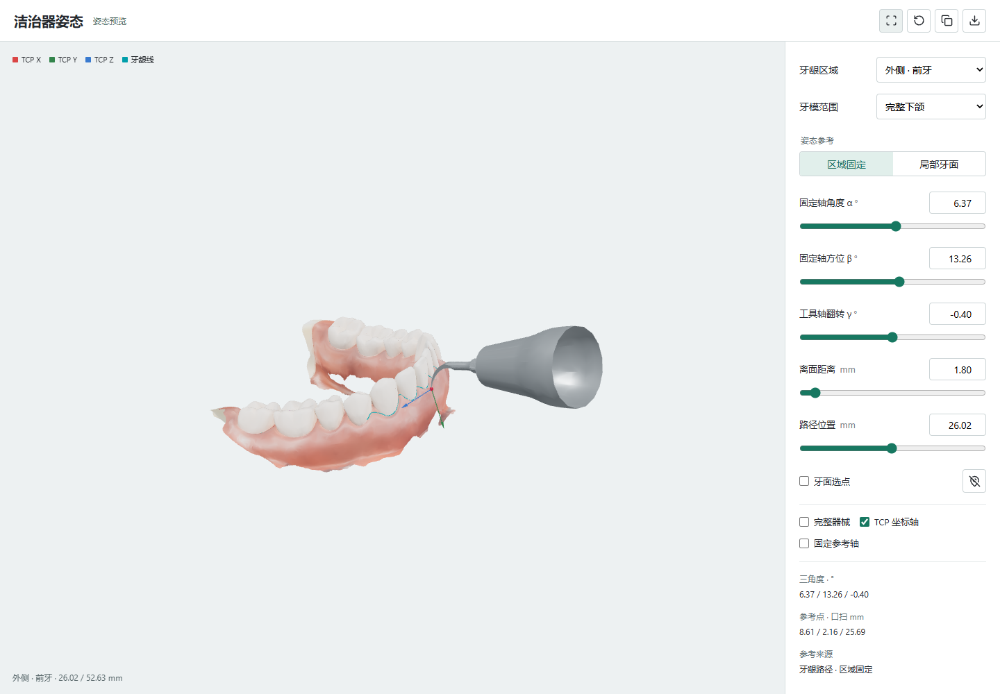
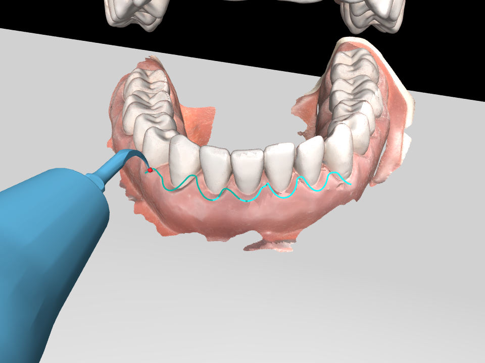
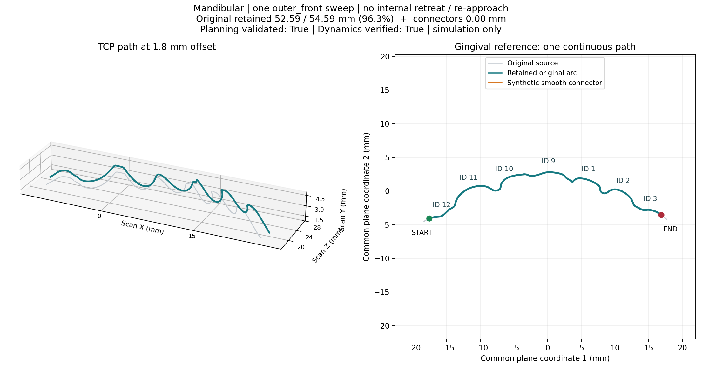

# Planning

Planning 只消费 perception 输出的 `PreparedRegion`。曲线拟合、逐牙分区、端点裁剪和牙间连续性保留属于
`perception/regions/`，planning 不再拥有牙龈线重构实现。

## 主入口

完整流程使用：

```powershell
.\.venv\Scripts\python.exe -m pipeline.run `
  --params config/pipeline_outer_front.json --headless
```

已有 perception 区域结果时，可以单独运行 planning：

```powershell
.\.venv\Scripts\python.exe -m planning `
  --perception-result outputs/perception/my_regions/outer_front `
  --pose-angles-deg 15 0 0 --out outputs/planning/my_front
```

独立 planning 适合复用保存的感知结果进行选角和模块开发。包含已验证参数的完整分步命令见
[项目使用指南](../README.md#4-可视化选角与轨迹规划)；上面 15° 示例仅展示参数格式，不保证通过。

## 参数文件

所有命令支持与 pipeline 相同的 `--params config/...json`。下面示例先读取 README 导出的感知结果，
主规划输出目录为 `outputs/planning/outer_front`；该目录必须为空。

```powershell
$py = ".\.venv\Scripts\python.exe"
& $py -m planning.visualization.pose_angles --params config/planning_pose_angles.json
& $py -m planning --params config/planning_outer_front.json --dry-run
& $py -m planning --params config/planning_outer_front.json
& $py -m planning.view --params config/planning_view.json
& $py -m planning.preview --params config/planning_preview.json
& $py -m planning.sweep_preview --params config/planning_preview.json
& $py -m planning.segment_map --params config/planning_segment_map.json
& $py -m planning.retime --params config/planning_retime.json
& $py -m planning.execute --params config/planning_execute.json
```

命令行优先于文件，例如 `--pose-angles-deg 35 -20 -141`、`--out outputs/planning/another_run`
或 `--no-headless`。文件中的路径相对于项目根目录，参数名、文件对应关系和布尔覆盖方法见
[config 说明](../config/README.md#planning-命令参数)。
`planning_execute.json` 默认按保存的时序执行；独立重计时命令输出的轨迹需要显式用 `--plan` 选择。
独立重计时保留源规划的关节速度、加速度和角速度限制；此前自动放大限制引起的求解失败已修复。
本例 90 s 重计时及加载执行已在干净环境通过，失败或低于可行时长的输出仍不可执行。
实测状态见 [README 命令验收](../docs/integration/2026-11-11-readme-command-audit.md)。

## 选角与预览

使用独立交互式查看器，拖动三个角度滑块实时观察洁治器姿态：

```powershell
.\.venv\Scripts\python.exe -m planning.visualization.pose_angles `
  --perception-result outputs/perception/my_regions/outer_front `
  --pose-angles-deg 6.37 13.26 -0.4 --standoff-mm 1.8 --jaw-opening-deg 20
```

不提供 `--perception-result` 时使用附带下颌数据。页面支持区域选择、路径位置、离面距离、
牙面选点和局部/完整牙模范围，可复制角度或导出预览姿态。
路径模式复用当前规划器的区域固定或局部牙面参考系，详见 [查看器说明](visualization/README.md)。



滑块选角不验证机器人可达性。指定 `--pose-angles-deg` 后，可用 `--check-mode geometry_only`
生成仅用于可达性预览的轨迹，再通过 `planning.view --plan <目录> --paused` 检查实际姿态。
选角完成后，在新目录以 `--check-mode full` 重新规划并验收，才可交给控制模块。
空格暂停/继续，`N`/`P` 逐路点，`R` 返回起点。



`python -m planning.preview --plan <目录>` 导出连续参考与 TCP 路径诊断：



## 姿态和避碰

默认模式是 `simple`。请求姿态使用三个角度：

1. `fixed_z_angle`：固定重力投影轴角度。
2. `fixed_y_azimuth`：固定区域参考 Y 轴方位角。
3. `tool_x_flip`：绕工具 +X 轴的翻转角。

规划器先尝试整区固定姿态；如果发生碰撞或 IK 不可达，则在三个角度各自 ±5° 内搜索可行姿态，
必要时对相邻姿态使用有界的连续小修正。所有候选仍需通过完整工具网格、双颌网格、自碰撞和轨迹动力学检查。

`continuous` 模式跟随局部牙面参考姿态，只有显式指定时才使用。`offset_mm=0` 只定义目标位置，
不会绕过碰撞保护，也不等于已经接触牙面。

## 代码边界

- `pose_search/`：姿态构造、候选姿态和连续 IK 分支搜索。
- `motion_planning/`：路径采样、初始进场、末端退出、关节样条、碰撞和动力学审计。
- `infrastructure/`：机器人、网格、轨迹、变换和文件指纹基础设施。
- `simple.py`：当前区域固定姿态策略和 ±5° 修正搜索。
- `pipeline.py`：消费 `PreparedRegion` 并生成 planning 输出。
- `visualization/`：交互式角度滑块、已保存轨迹的回放和诊断图。

每次只规划一个六区域名称，不自动串行执行全口。默认仅去除整区两端各 1 mm，不生成跨牙补线。
六区域数据集缺失或不匹配时直接报错；区域名称不接受旧三分区别名。

旧分段规划及 planning 侧牙龈线重构接口不再是受支持入口；交互式选角入口为 `planning.visualization.pose_angles`。
