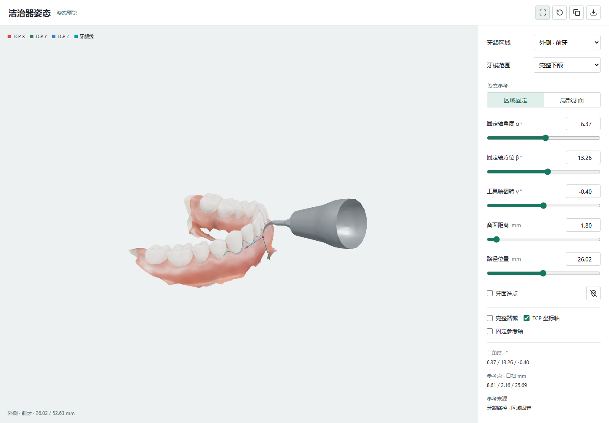
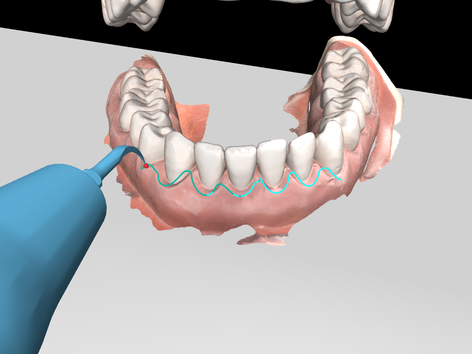
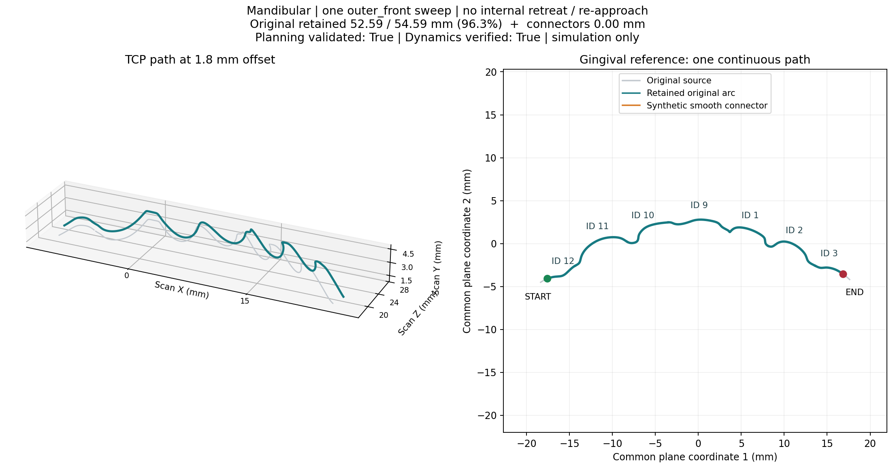

# Planning

Planning 只消费 perception 输出的 `PreparedRegion`。曲线拟合、逐牙分区、端点裁剪和牙间连续性保留属于
`perception/regions/`，planning 不再拥有牙龈线重构实现。

## 主入口

完整流程使用：

```powershell
.\.venv\Scripts\python.exe -m pipeline.run `
  --params config/pipeline_outer_front.json --headless
```

已有 perception 区域结果时，可以单独运行 planning：

```powershell
.\.venv\Scripts\python.exe -m planning `
  --perception-result outputs/perception/my_regions/outer_front `
  --pose-angles-deg 15 0 0 --out outputs/planning/my_front
```

### 使用真机腕部相机 session 恢复仿真位姿

`wyh` session 已把扫描区域发布为 `controller_base` 坐标（米）。指定
`--perception-session` 后，入口读取该 session 的标定/相机外参/配准链和区域几何，
将仿真 `ur_base`（ROS `base_link` 轴约定）通过固定 `Rz(pi)` 适配到
`controller_base`，并把机械臂设置到 `robot_joint_observation.json` 中记录的拍摄关节角：

```powershell
$py = ".\\.venv\\Scripts\\python.exe"
& $py -m planning `
  --perception-session assets/perception/sessions/20261113_220209 `
  --jaw mandibular --region outer_front `
  --planning-mode continuous --check-mode geometry_only `
  --pose-spacing-mm 2 --out outputs/planning/wyh_outer_front
& $py -m planning.view --plan outputs/planning/wyh_outer_front --paused
```

变换方向是 `T_world_scan = T_world_ur_base @ T_ur_base_controller_base @
T_controller_base_scan`；其中 `T_controller_base_scan` 会由
`T_controller_base_wrist3 × T_wrist3_color_frame × T_color_frame_depth_optical ×
T_depth_optical_scan` 重算并与发布矩阵校验。session 中的
`points_controller_base_nominal_m.csv` 已经在 controller base 中，不能再次乘
`T_controller_base_scan`。输出会记录适配版本、关节角、矩阵链和牙颌场景变换，并保留
`robot_execution_allowed=false`。真机手眼 YAML 只作为来源记录，不被当作未经验证的
`T_base_camera`。完整碰撞规划仍使用 `--check-mode full`，并应在新目录中重新验收。

对于本次拍摄中镜头与洁治器大致同向的安装，可显式选择光学帧候选解释。
该解释把归档手眼数值视为 `T_wrist3_color_optical`，使用 SDK 的
`T_color_optical_depth_optical`，不再叠加 ROS stream/optical 轴转换：

```text
T_controller_base_scan_effective = T_controller_base_wrist3
  @ T_wrist3_color_optical @ T_color_optical_depth_optical @ T_depth_optical_scan
```

只查看拍摄姿态和牙模相对位置（不进行 IK、避碰、时序或控制）：

```powershell
$py = ".\.venv\Scripts\python.exe"
& $py -m planning --params config/planning_session_optical_preview.json --dry-run
& $py -m planning --params config/planning_session_optical_preview.json
& $py -m planning.view --plan outputs/planning/session_optical_preview --paused --distance 1.2
```

输出目录必须为空；重复导出时用 `--out outputs/planning/<新目录>`，查看时选择相同目录。
新建 session 仿真/规划时默认使用 `color_optical`，无需再指定模式；
需要原始发布解释时显式加 `--session-camera-frame declared`。JSON 中的显式模式仍可被 CLI 覆盖。
已有输出的回放按保存的模式重建，无解释版本的旧输出仍使用 `declared`，不受新默认值影响。
光学帧候选解释与照片空间关系更一致，
但尚未独立核实现场 TF，不代表标定绝对精度已验证。

程序首先验证原发布链及源文件指纹，再派生有效矩阵；base 点同步变换，法向和切向只旋转，
口扫局部几何及六个拍摄关节角不变。有效矩阵同时用于牙模和规划 PreparedRegion。
保存的 session 记录包含解释版本、原始与有效矩阵及依赖指纹；回放会按保存的解释重建并核对，
不会自动把旧输出改为光学帧。切换解释后需在新目录重新规划。
上下颌模型均可摆位；当前本机缺少上颌区域依赖的 `assets/regional_paths/maxillary/metadata.json`，
因此以上示例使用下颌。光学帧候选继续保留 `robot_execution_allowed=false`。

独立 planning 适合复用保存的感知结果进行选角和模块开发。包含已验证参数的完整分步命令见
[项目使用指南](../README.md#4-可视化选角与轨迹规划)；上面 15° 示例仅展示参数格式，不保证通过。

## 参数文件

所有命令支持与 pipeline 相同的 `--params config/...json`。下面示例先读取 README 导出的感知结果，
主规划输出目录为 `outputs/planning/outer_front`；该目录必须为空。

```powershell
$py = ".\.venv\Scripts\python.exe"
& $py -m planning.visualization.pose_angles --params config/planning_pose_angles.json
& $py -m planning --params config/planning_outer_front.json --dry-run
& $py -m planning --params config/planning_outer_front.json
& $py -m planning.view --params config/planning_view.json
& $py -m planning.preview --params config/planning_preview.json
& $py -m planning.sweep_preview --params config/planning_preview.json
& $py -m planning.segment_map --params config/planning_segment_map.json
& $py -m planning.retime --params config/planning_retime.json
& $py -m planning.execute --params config/planning_execute.json
```

命令行优先于文件，例如 `--pose-angles-deg 35 -20 -141`、`--out outputs/planning/another_run`
或 `--no-headless`。文件中的路径相对于项目根目录，参数名、文件对应关系和布尔覆盖方法见
[config 说明](../config/README.md#planning-命令参数)。
`planning_execute.json` 默认按保存的时序执行；独立重计时命令输出的轨迹需要显式用 `--plan` 选择。
独立重计时保留源规划的关节速度、加速度和角速度限制；此前自动放大限制引起的求解失败已修复。
本例 90 s 重计时及加载执行已在干净环境通过，失败或低于可行时长的输出仍不可执行。
实测状态见 [README 命令验收](../docs/integration/2026-11-11-readme-command-audit.md)。

## 选角与预览

使用独立交互式查看器，拖动三个角度滑块实时观察洁治器姿态：

```powershell
.\.venv\Scripts\python.exe -m planning.visualization.pose_angles `
  --perception-result outputs/perception/my_regions/outer_front `
  --pose-angles-deg 6.37 13.26 -0.4 --standoff-mm 1.8 --jaw-opening-deg 20
```

不提供 `--perception-result` 时使用附带下颌数据。页面支持区域选择、路径位置、离面距离、
牙面选点和局部/完整牙模范围，可复制角度或导出预览姿态。
路径模式复用当前规划器的区域固定或局部牙面参考系，详见 [查看器说明](visualization/README.md)。



滑块选角不验证机器人可达性。指定 `--pose-angles-deg` 后，可用 `--check-mode geometry_only`
生成仅用于可达性预览的轨迹，再通过 `planning.view --plan <目录> --paused` 检查实际姿态。
选角完成后，在新目录以 `--check-mode full` 重新规划并验收，才可交给控制模块。
空格暂停/继续，`N`/`P` 逐路点，`R` 返回起点。



`python -m planning.preview --plan <目录>` 导出连续参考与 TCP 路径诊断：



## 姿态和避碰

默认模式是 `simple`。请求姿态使用三个角度：

1. `fixed_z_angle`：固定重力投影轴角度。
2. `fixed_y_azimuth`：固定区域参考 Y 轴方位角。
3. `tool_x_flip`：绕工具 +X 轴的翻转角。

规划器先尝试整区固定姿态；如果发生碰撞或 IK 不可达，则在三个角度各自 ±5° 内搜索可行姿态，
必要时对相邻姿态使用有界的连续小修正。所有候选仍需通过完整工具网格、双颌网格、自碰撞和轨迹动力学检查。

逐位置局部修正可用 `--no-local-angle-search` 或 JSON 中的 `"local_angle_search": false` 关闭。
关闭后只尝试标称姿态和整区统一的 125 组角度修正，失败即返回，不进入逐位置搜索。
代码默认值为 `true`，接触规划示例已设为 `false`；`--local-angle-search` 可重新启用。

新增 `local_surface` 模式：每个路径位置都使用该处牙面法线及重力投影建立参考系，
与姿态查看器中的“局部牙面”一致。三个角度仍可分别在 ±5° 内修正；修正始终相对该位置的
原始请求角度，不随路径累计。跨牙处沿用 perception 已有的平滑法线过渡，不改变原始路径。
`continuous` 模式严格保持局部请求角度，不搜索角度修正。默认仍为 `simple`。

局部牙面 `50, 0, 50` 的配套参数文件：

```powershell
& $py -m planning.visualization.pose_angles --params config/planning_pose_angles_local_surface.json
& $py -m planning --params config/planning_local_surface.json --out outputs/planning/my_local_surface
& $py -m planning.view --plan outputs/planning/my_local_surface --paused
```

该配置使用下颌前牙、1.8 mm 离面距离和 20° 张口角，已通过完整仿真验收；
详见 [局部牙面模式验证](../docs/superpowers/specs/2026-11-12-local-surface-planning-validation.md)。
保存的参考与执行验收会核对局部参考系及实际 FK 的 ±5° 限制。
`offset_mm=0` 只定义目标位置，
不会绕过碰撞保护，也不等于已经接触牙面。

### 理想工作区接触

新建 `contact` 模式规划（`--motion-mode contact` 或 `--standoff-mm 0`）会启用工作区接触策略：

| 参数 | 默认值 | 含义 |
| --- | --- | --- |
| `working_segment_radius_mm` | 1.0 mm | 以实际 TCP 为球心的工作区半径 |
| `contact_tolerance_mm` | 0.05 mm | 工作区的局部有向间隙不得小于其负值 |
| `nonworking_clearance_mm` | 0.0 mm | 非工作部位与牙颌的距离必须严格大于此值 |

只有洁治器网格的三个顶点都在球内的三角面属于工作区。当前模型划分为 48 个工作面片和
8102 个非工作面片；跨球边界的 36 个面片包含在非工作区中。工作区可接触全部已加载的上下颌，
非工作区、传感器、其他机器人部件以及自碰撞仍受检查。默认非工作间隙为 0 仍不接受相交或相切。

```powershell
.\.venv\Scripts\python.exe -m planning --params config/planning_contact.json --dry-run
.\.venv\Scripts\python.exe -m planning --params config/planning_contact.json --nonworking-clearance-mm 0.1
.\.venv\Scripts\python.exe -m planning --params config/planning_contact.json --standoff-mm 0.14 --out outputs/planning/contact_front_offset014
```

例中的角度只是待检查的参考姿态，不保证原线可行。该策略不移动原线，不提供接触力控制。
显式 `contact` 模式也允许正的离面距离，例如 `0.14 mm`，只偏移 TCP 目标，仍沿用同一接触策略。
非接触模式的 `clearance_mm` 默认值为 `0 mm`：取消额外余量，但最近距离仍须严格大于零，接触、相交和自碰撞仍被拒绝。
旧轨迹按保存的间隙验收；历史配置缺失该字段时仍恢复原默认 `0.15 mm`。零余量不代表真机安全认证。
旧接触规划加载时保持原来的整工具禁止接触策略；
应用新策略需要重新规划。

当前检测使用 FCL 原始牙颌三角网格和 MuJoCo 机器人自碰撞检查。网格远离时先做包围盒筛选，
靠近时进行网格查询；IK 相邻边和最终轨迹另做有限间距采样。FCL 的 `-1` 相交标记不表示穿透深度。
原始口扫是开放网格，新工作区检测需要可信的局部有向面片支持；无法确认侧别或完整覆盖时拒绝并记录
`contact_unverifiable`，不使用无符号距离冒充接触间隙。输出应按实际后端的局部验证范围解读，
不构成开放口扫的全局实体内外证明。

局部支持采用原始面片组成的分片平面高度场，检查完整工作三角面的投影覆盖和内部交点，
并给出保守有向间隙。周围弯曲面片不能组成同一高度场时，先缩小支持邻域，再按工作面片建立
各自的局部方向；必要时把一个工作面片完整细分，最多两层，每个子面仍须通过解析覆盖和间隙检查。
排除牙面片前，必须证明其投影与工作面不相交，或它位于完整工具到牙面线段的范围外；
包围盒过于宽松时使用 FCL 原始三角形距离作排除证明。邻近点查询只选择参考方向，不提供接触证书。
这个间隙不是欧氏最近有符号距离；相关范围内的折叠、重叠面层、孔洞或覆盖不足仍会拒绝验证。
整颌包围盒重叠时，可由原始网格最近点选择一个候选分离方向；只有工作区和全部牙颌顶点沿该方向
存在大于 2 mm 的投影间隔，才确认远离并不报告有符号间隙。无符号最近距离本身不构成放行条件。

`tool_contact_manifest.json` 保存工作面片索引、半径、TCP 变换和网格标识。
规划与执行报告将工作区有向间隙和非工作区间隙分开记录；执行与重计时会检查策略和几何标识。
局部支持修复后的后端标识为 `whole_triangle_oriented_heightfield_v3`；旧后端产物需要重新规划。

## 直线进场与返回

新生成的区域轨迹按 `起始位姿 -> 牙龈线起点 -> 沿线 -> 牙龈线终点 -> 起始位姿` 运动。
进场与返回均以 TCP 在 world 坐标中的空间直线为参考，方向采用端点间最短 Slerp 插值。
起始位姿取本次初始化的 `robot.home`；session 使用采集时的关节姿态，返回时精确恢复原关节值。
沿线首末位姿包含现有离面偏置和整区裁剪，不额外取消偏置。

自由段内部连续运动，仅各阶段端点停车；沿线 IK 节点及 TOPPRA 保持原有策略。
新策略不再尝试偏移进场、关节绕行或法向退出，历史 `retreat_mm` 不参与新直线返回。
直线不可达、固定端点分支不连续或 full 检查发现碰撞时直接失败。
`geometry_only` 仍跳过碰撞和动力学，生成的轨迹只可用于几何预览。

`transfer_reference.json` 保存两段端点、关节姿态和策略版本，并通过 request/report 的指纹校验。
`transfer_audit` 检查最终时间插值的 FK、有限线段单调进度及方向误差，沿用位置 `0.1 mm`、
方向 `1 度` 容差。这是有限采样验证；重计时保留自由段多项式几何，旧轨迹不自动转换。
相关回归：`.\.venv\Scripts\python.exe -m unittest planning.test_straight_transfers -q`。

## 代码边界

- `pose_search/`：姿态构造、候选姿态和连续 IK 分支搜索。
- `motion_planning/`：路径采样、初始进场、末端退出、关节样条、碰撞和动力学审计。
- `infrastructure/`：机器人、网格、轨迹、变换和文件指纹基础设施。
- `simple.py`：区域固定/局部牙面姿态策略及共享的 ±5° 修正搜索。
- `pipeline.py`：消费 `PreparedRegion` 并生成 planning 输出。
- `visualization/`：交互式角度滑块、已保存轨迹的回放和诊断图。

每次只规划一个六区域名称，不自动串行执行全口。默认仅去除整区两端各 1 mm，不生成跨牙补线。
六区域数据集缺失或不匹配时直接报错；区域名称不接受旧三分区别名。

旧分段规划及 planning 侧牙龈线重构接口不再是受支持入口；交互式选角入口为 `planning.visualization.pose_angles`。
